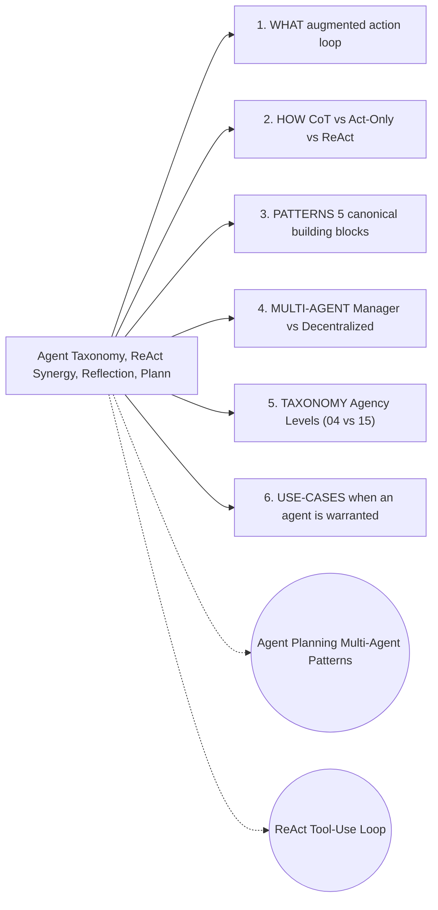

# Cheatsheet — Agent Taxonomy, ReAct Synergy, Reflection, Planning & Multi-Agent Orchestration

> [!summary] 10-Second Visual Hook
> Interleave verbal thoughts ($\mathcal{L}$) with external actions ($\mathcal{A}$) inside bounded, guarded feedback loops

- **Full Monograph:** [[Agent Taxonomy, ReAct Synergy, Reflection, Planning & Multi-Agent Orchestration]]
- **Sub-Topic MOC:** [[ST 07 - Agent Taxonomies, ReAct, Planning & Multi-Agent Patterns]]
- **Atomic Concepts:** [[Agent Planning & Multi-Agent Patterns]], [[ReAct & Tool-Use Loop]]

## Interactive Mindmap Overview

## Branch Summary & Key Equations

- **1. WHAT — augmented action loop**
  $$
  \hat{\mathcal{A}} = \mathcal{A} \cup \mathcal{L}
  $$
- **2. HOW — CoT vs Act-Only vs ReAct**
- **3. PATTERNS — 5 canonical building blocks**
- **4. MULTI-AGENT — Manager vs Decentralized**
- **5. TAXONOMY — Agency Levels (0–4 vs 1–5)**
- **6. USE-CASES — when an agent is warranted**

## Related Sources

[[Source - A practical]], [[Source - Agents Book]], [[Source - Introduction to]], [[Source - Published as a conference paper at ICLR 2023]], [[Source - Speech and Language Processing]]
