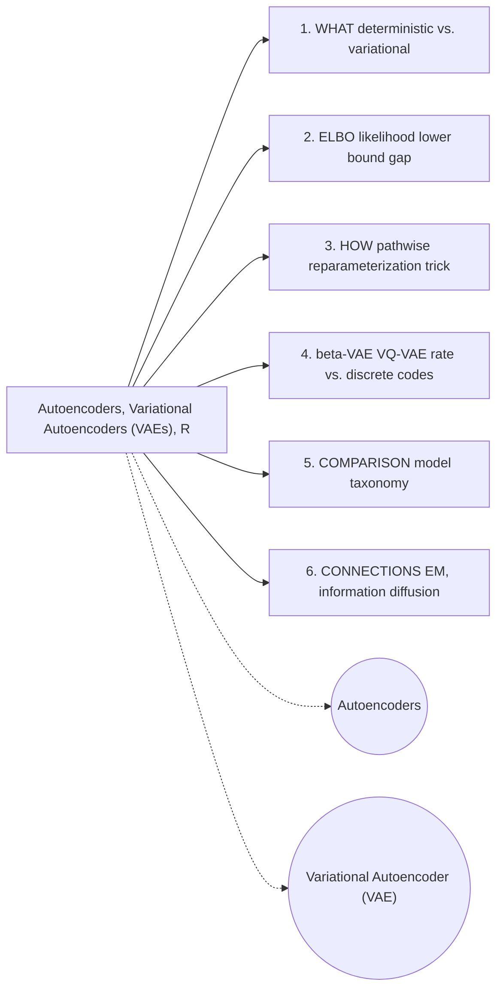

# Cheatsheet — Autoencoders, Variational Autoencoders (VAEs), Reparameterization & VQ-VAE

> [!summary] 10-Second Visual Hook
> Compress $\boldsymbol{x}$ to a prior-regularized latent bottleneck $\boldsymbol{z}$; sample via reparameterization or discrete codebooks

- **Full Monograph:** [[Autoencoders, Variational Autoencoders (VAEs), Reparameterization & VQ-VAE]]
- **Sub-Topic MOC:** [[ST 04 - Autoencoders, Variational Autoencoders & Normalizing Flows]]
- **Atomic Concepts:** [[Autoencoders]], [[Variational Autoencoder (VAE)]]

## Interactive Mindmap Overview

## Branch Summary & Key Equations

- **1. WHAT — deterministic vs. variational**
  $$
  p_\theta(\boldsymbol{x},\boldsymbol{z})=p(\boldsymbol{z}) p_\theta(\boldsymbol{x}\mid\boldsymbol{z})
  $$
- **2. ELBO — likelihood lower bound & gap**
  $$
  \mathcal L_{\mathrm{ELBO}}(\theta,\phi;\boldsymbol{x})=\underbrace{\mathbb{E}_{q_\phi(\boldsymbol{z}\mid\boldsymbol{x})}[\log p_\theta(\boldsymbol{x}\mid\boldsymbol{z})]}_{\text{Reconstruction }(-D)}-\underbrace{D_{\mathrm{KL}}(q_\phi(\boldsymbol{z}\mid\boldsymbol{x}) \parallel p(\boldsymbol{z}))}_{\text{Prior Matching / Rate }R}
  $$
- **3. HOW — pathwise reparameterization trick**
  $$
  \boldsymbol{z}=g_\phi(\boldsymbol{\epsilon},\boldsymbol{x})=\boldsymbol{\mu}_\phi(\boldsymbol{x})+\boldsymbol{\sigma}_\phi(\boldsymbol{x})\odot\boldsymbol{\epsilon}
  $$
- **4. $\beta$-VAE & VQ-VAE — rate vs. discrete codes**
- **5. COMPARISON — model taxonomy**
- **6. CONNECTIONS — EM, information & diffusion**

## Related Sources

[[Source - Deep Learning]], [[Source - Foundations]], [[Source - Probabilistic Machine Learning]], [[Source - The Principles of Diffusion Models]], [[Source - Tutorial on Diffusion Models for Imaging and Vision]], [[Source - Understanding Deep Learning]]
