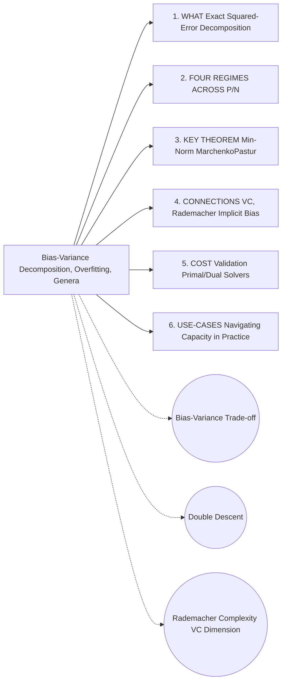

# Cheatsheet — Bias-Variance Decomposition, Overfitting, Generalization & Double Descent

> [!summary] 10-Second Visual Hook
> Test risk = $\mathrm{Bias}^2 + \mathrm{Var} + \sigma_\epsilon^2$; variance blows up at $P=N$ then falls again via min-norm interpolation

- **Full Monograph:** [[Bias-Variance Decomposition, Overfitting, Generalization & Double Descent]]
- **Sub-Topic MOC:** [[ST 02 - Linear, Regularized & Generalized Linear Models]]
- **Atomic Concepts:** [[Bias-Variance Trade-off]], [[Double Descent]], [[Rademacher Complexity & VC Dimension]]

## Interactive Mindmap Overview

## Branch Summary & Key Equations

- **1. WHAT — Exact Squared-Error Decomposition**
  $$
  \mathbb{E}_{\mathcal D,\epsilon}\!\big[(y-\hat f_{\mathcal D}(\boldsymbol{x}))^2\big]=\mathrm{Bias}^2+\mathrm{Var}+\sigma_\epsilon^2
  $$
- **2. FOUR REGIMES ACROSS $P/N$**
- **3. KEY THEOREM — Min-Norm & Marchenko–Pastur**
  $$
  \hat{\boldsymbol{w}}_{\min}=\arg\min_{\boldsymbol{\Phi}\boldsymbol{w}=\boldsymbol{y}}\lVert \boldsymbol{w} \rVert_2=\boldsymbol{\Phi}^{+}\boldsymbol{y}=\boldsymbol{\Phi}^{\top}(\boldsymbol{\Phi}\boldsymbol{\Phi}^{\top})^{-1}\boldsymbol{y}
  $$
- **4. CONNECTIONS — VC, Rademacher & Implicit Bias**
- **5. COST — Validation & Primal/Dual Solvers**
- **6. USE-CASES — Navigating Capacity in Practice**

## Related Sources

[[Source - Deep Learning]], [[Source - Foundations]], [[Source - Introduction-PROBABILITY-for-DATA-SCIENCE]], [[Source - Machine Learning co ban]], [[Source - Understanding Deep Learning]]
