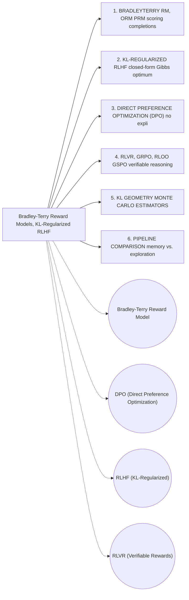

# Cheatsheet — Bradley-Terry Reward Models, KL-Regularized RLHF, Direct Preference Optimization (DPO) & RLVR

> [!summary] 10-Second Visual Hook
> Tilt the reference policy by reward over KL; reparameterize preferences in closed form or verify reasoning directly

- **Full Monograph:** [[Bradley-Terry Reward Models, KL-Regularized RLHF, Direct Preference Optimization (DPO) & RLVR]]
- **Sub-Topic MOC:** [[ST 06 - Post-Training Alignment - RLHF, Reward Modeling, DPO & RLVR]]
- **Atomic Concepts:** [[Bradley-Terry Reward Model]], [[DPO (Direct Preference Optimization)]], [[RLHF (KL-Regularized)]], [[RLVR (Verifiable Rewards)]]

## Interactive Mindmap Overview

## Branch Summary & Key Equations

- **1. BRADLEY–TERRY RM, ORM & PRM — scoring completions**
  $$
  P(y_w\succ y_l\mid x)=\sigma\big(r^*(x,y_w)-r^*(x,y_l)\big),\quad \mathcal{L}_{\mathrm{RM}}(\phi)=-\mathbb{E}\Big[\log\sigma\big(r_\phi(x,y_w)-r_\phi(x,y_l)-m\big)\Big]
  $$
- **2. KL-REGULARIZED RLHF — closed-form Gibbs optimum**
  $$
  \max_{\pi} \mathbb{E}_{x\sim\mathcal{D}}\Big[\mathbb{E}_{y\sim\pi(\cdot\mid x)}[r_\phi(x,y) ] - \beta D_{\mathrm{KL}}(\pi(y\mid x) \parallel \pi_{\mathrm{ref}}(y\mid x))\Big]
  $$
- **3. DIRECT PREFERENCE OPTIMIZATION (DPO) — no explicit RM**
  $$
  \mathcal{L}_{\mathrm{DPO}}(\theta) = -\mathbb{E}\!\left[\log\sigma\!\left(\beta\log\frac{\pi_\theta(y_w\mid x)}{\pi_{\mathrm{ref}}(y_w\mid x)} - \beta\log\frac{\pi_\theta(y_l\mid x)}{\pi_{\mathrm{ref}}(y_l\mid x)}\right)\right]
  $$
- **4. RLVR, GRPO, RLOO & GSPO — verifiable reasoning**
  $$
  A_i^{\mathrm{GRPO}}=\frac{r_i-\mathrm{mean}(r_{1:G})}{\mathrm{std}(r_{1:G})},\qquad \rho_i^{\mathrm{GSPO}}(\theta)=\left(\frac{\pi_\theta(y_i\mid x)}{\pi_{\theta_{\mathrm{old}}}(y_i\mid x)}\right)^{1/|y_i|}
  $$
- **5. KL GEOMETRY & MONTE CARLO ESTIMATORS**
- **6. PIPELINE COMPARISON — memory vs. exploration**

## Related Sources

[[Source - Foundations of Large Language Models]], [[Source - Reinforcement Learning - An Overview]], [[Source - Reinforcement Learning from Human Feedback]], [[Source - Speech and Language Processing]], [[Source - The Principles of Diffusion Models]]
