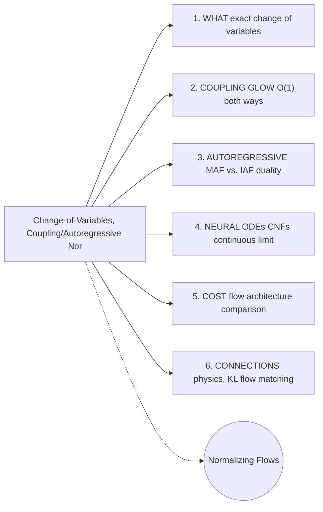

# Cheatsheet — Change-of-Variables, Coupling/Autoregressive Normalizing Flows & Neural ODEs

> [!summary] 10-Second Visual Hook
> Push a base Gaussian through invertible maps or ODE vector fields; track exact density via Jacobian log-determinants or traces

- **Full Monograph:** [[Change-of-Variables, Coupling - Autoregressive Normalizing Flows & Neural ODEs]]
- **Sub-Topic MOC:** [[ST 04 - Autoencoders, Variational Autoencoders & Normalizing Flows]]
- **Atomic Concepts:** [[Normalizing Flows]]

## Interactive Mindmap Overview

## Branch Summary & Key Equations

- **1. WHAT — exact change of variables**
  $$
  \log p_X(\boldsymbol{x})=\log p_Z\!\bigl(f_\theta^{-1}(\boldsymbol{x})\bigr)+\log\lvert \det\boldsymbol{J}_{f_\theta^{-1}}(\boldsymbol{x}) \rvert
  $$
- **2. COUPLING & GLOW — O(1) both ways**
  $$
  \boldsymbol{x}_A=\boldsymbol{z}_A,\quad \boldsymbol{x}_B=e^{\boldsymbol{s}(\boldsymbol{z}_A)}\odot\boldsymbol{z}_B+\boldsymbol{t}(\boldsymbol{z}_A)
  $$
- **3. AUTOREGRESSIVE — MAF vs. IAF duality**
  $$
  \text{**MAF**: }x_i=z_i e^{\alpha_i(\boldsymbol{x}_{1:i-1})}+\mu_i(\boldsymbol{x}_{1:i-1})\quad\text{**IAF**: }x_i=z_i e^{\alpha_i(\boldsymbol{z}_{1:i-1})}+\mu_i(\boldsymbol{z}_{1:i-1})
  $$
- **4. NEURAL ODEs & CNFs — continuous limit**
  $$
  \frac{\mathrm{d}\boldsymbol{z}(t)}{\mathrm{d}t}=\boldsymbol{v}_\theta(\boldsymbol{z}(t),t),\quad \frac{\mathrm{d}}{\mathrm{d}t}\log p_t(\boldsymbol{z}_t)=-\nabla_{\boldsymbol{z}}\cdot\boldsymbol{v}_\theta
  $$
- **5. COST — flow architecture comparison**
- **6. CONNECTIONS — physics, KL & flow matching**

## Related Sources

[[Source - Foundations]], [[Source - Probabilistic Machine Learning]], [[Source - The Principles of Diffusion Models]], [[Source - Understanding Deep Learning]]
