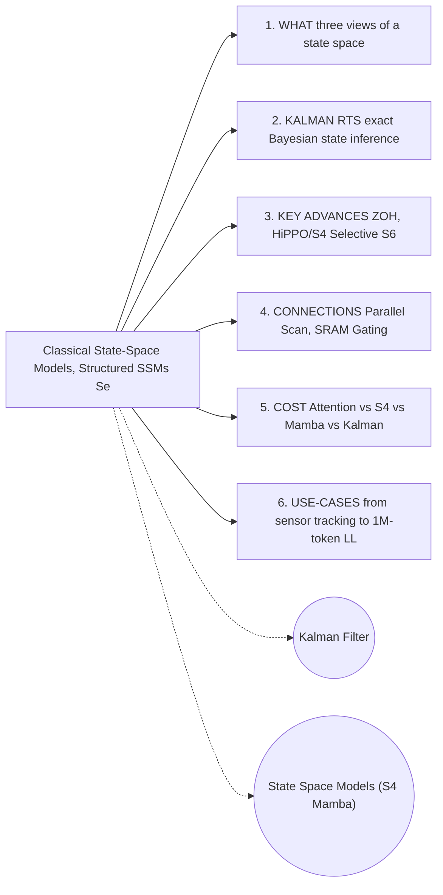

# Cheatsheet — Classical State-Space Models, Structured SSMs & Selective Scan (Mamba)

> [!summary] 10-Second Visual Hook
> Compress history into a Markovian state: Bayesian Kalman/RTS, LTI S4 via FFT, and input-selective Mamba ($S6$) in $O(L)$

- **Full Monograph:** [[Classical State-Space Models, Structured SSMs & Selective Scan (Mamba)]]
- **Sub-Topic MOC:** [[ST 03 - Recurrent Networks & Selective State-Space Models (Mamba)]]
- **Atomic Concepts:** [[Kalman Filter]], [[State Space Models (S4 & Mamba)]]

## Interactive Mindmap Overview

## Branch Summary & Key Equations

- **1. WHAT — three views of a state space**
  $$
  \dot{\boldsymbol{h}}(t)=\boldsymbol{A}\boldsymbol{h}(t)+\boldsymbol{B}x(t),  y(t)=\boldsymbol{C}\boldsymbol{h}(t)+Dx(t)
  $$
- **2. KALMAN & RTS — exact Bayesian state inference**
- **3. KEY ADVANCES — ZOH, HiPPO/S4 & Selective $S6$**
  $$
  \bar{\boldsymbol{A}}_t = \exp(\Delta_t\boldsymbol{A}),  \bar{\boldsymbol{B}}_t = (\Delta_t\boldsymbol{A})^{-1}\bigl(\exp(\Delta_t\boldsymbol{A})-\boldsymbol{I}\bigr)\Delta_t\boldsymbol{B}_t
  $$
- **4. CONNECTIONS — Parallel Scan, SRAM & Gating**
  $$
  (\boldsymbol{M}_2,\boldsymbol{v}_2)\bullet(\boldsymbol{M}_1,\boldsymbol{v}_1)=(\boldsymbol{M}_2\boldsymbol{M}_1, \boldsymbol{M}_2\boldsymbol{v}_1+\boldsymbol{v}_2)
  $$
- **5. COST — Attention vs S4 vs Mamba vs Kalman**
- **6. USE-CASES — from sensor tracking to 1M-token LLMs**

## Related Sources

[[Source - Foundations of Large Language Models]], [[Source - Probabilistic Machine Learning]], [[Source - Report - Mamba When Transformer is Not All You Need - AIVN]]
