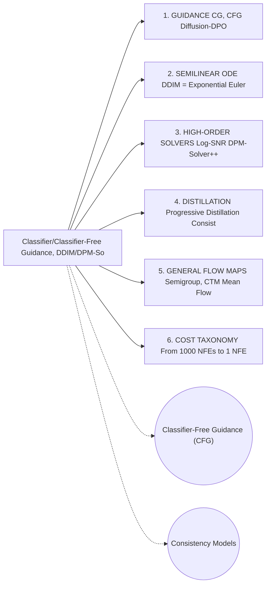

# Cheatsheet — Classifier/Classifier-Free Guidance, DDIM/DPM-Solver ODEs & Consistency Models

> [!summary] 10-Second Visual Hook
> Steer scores with CFG, integrate semilinear ODEs in log-SNR, and jump in 1 step via semigroup flow maps

- **Full Monograph:** [[Classifier - Classifier-Free Guidance, DDIM - DPM-Solver ODEs & Consistency Models]]
- **Sub-Topic MOC:** [[ST 04 - Guidance, Fast ODE Solvers & Consistency Distillation]]
- **Atomic Concepts:** [[Classifier-Free Guidance (CFG)]], [[Consistency Models]]

## Interactive Mindmap Overview

## Branch Summary & Key Equations

- **1. GUIDANCE — CG, CFG & Diffusion-DPO**
  $$
  \boldsymbol{s}_\phi^{\mathrm{CFG}}(\boldsymbol{x}_t,t,\boldsymbol{c};\omega)=\omega\boldsymbol{s}_\phi(\boldsymbol{x}_t,t,\boldsymbol{c})+(1-\omega)\boldsymbol{s}_\phi(\boldsymbol{x}_t,t,\emptyset)
  $$
- **2. SEMILINEAR ODE — DDIM = Exponential Euler**
  $$
  \frac{\mathrm{d}\boldsymbol{x}_t}{\mathrm{d}t}=\underbrace{\frac{\alpha_t'}{\alpha_t}\boldsymbol{x}_t}_{\text{linear drift}}+\underbrace{\frac{g^2(t)}{2\sigma_t}\boldsymbol\epsilon_\phi(\boldsymbol{x}_t,t)}_{\text{nonlinear residual}}
  $$
- **3. HIGH-ORDER SOLVERS — Log-SNR & DPM-Solver++**
  $$
  \tilde\Psi_{s\to t}(\boldsymbol{x}_s)=\frac{\alpha_t}{\alpha_s}\boldsymbol{x}_s-\alpha_t\int_{\lambda_s}^{\lambda_t}e^{-\lambda}\hat{\boldsymbol\epsilon}_\phi(\hat{\boldsymbol{x}}_\lambda,\lambda) \mathrm{d}\lambda
  $$
- **4. DISTILLATION — Progressive Distillation & Consistency**
- **5. GENERAL FLOW MAPS — Semigroup, CTM & Mean Flow**
  $$
  \Psi_{u\to t}\circ\Psi_{s\to u}=\Psi_{s\to t},  \Psi_{s\to s}=\mathrm{Id} (\forall  s\ge u\ge t\ge 0)
  $$
- **6. COST & TAXONOMY — From 1000 NFEs to 1 NFE**

## Related Sources

[[Source - Foundations]], [[Source - Probabilistic Machine Learning]], [[Source - The Principles of Diffusion Models]]
