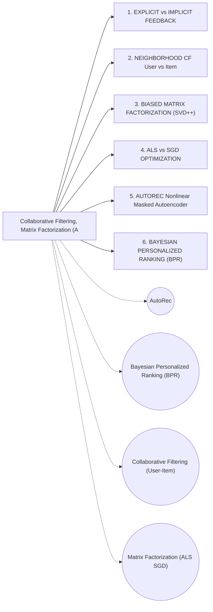

# Cheatsheet — Collaborative Filtering, Matrix Factorization (ALS/SGD), AutoRec & Bayesian Personalized Ranking (BPR)

> [!summary] 10-Second Visual Hook
> Factorize sparse user-item matrices into low-rank latent embeddings or optimize pairwise preference margins via BPR

- **Full Monograph:** [[Collaborative Filtering, Matrix Factorization (ALS - SGD), AutoRec & Bayesian Personalized Ranking (BPR)]]
- **Sub-Topic MOC:** [[ST 07 - Collaborative Filtering, Matrix Factorization & Implicit Feedback Ranking]]
- **Atomic Concepts:** [[AutoRec]], [[Bayesian Personalized Ranking (BPR)]], [[Collaborative Filtering (User-Item)]], [[Matrix Factorization (ALS & SGD)]]

## Interactive Mindmap Overview

## Branch Summary & Key Equations

- **1. EXPLICIT vs IMPLICIT FEEDBACK**
- **2. NEIGHBORHOOD CF — User vs Item**
  $$
  \hat y_{ui}=\bar y_u + \frac{\sum_{j\in\mathcal N_u(i)}\mathrm{sim}(i,j)(y_{uj}-\bar y_u)}{\sum_j |\mathrm{sim}(i,j)|}
  $$
- **3. BIASED MATRIX FACTORIZATION (SVD++)**
  $$
  \hat y_{ui}=\mu+b_u+b_i+\boldsymbol{p}_u^{\top}\boldsymbol{q}_i,  \min_{\boldsymbol{P},\boldsymbol{Q}}\sum_{\Omega}(y_{ui}-\hat y_{ui})^2+\lambda(\lVert \boldsymbol{P} \rVert_F^2+\lVert \boldsymbol{Q} \rVert_F^2)
  $$
- **4. ALS vs SGD OPTIMIZATION**
  $$
  \boldsymbol{p}_u \gets \Bigl(\sum_{i\in\Omega_u}\boldsymbol{q}_i\boldsymbol{q}_i^{\top} + \lambda\boldsymbol{I}_K\Bigr)^{-1}\sum_{i\in\Omega_u}(y_{ui}-\mu-b_u-b_i)\boldsymbol{q}_i
  $$
- **5. AUTOREC — Nonlinear Masked Autoencoder**
  $$
  \mathcal L_{\mathrm{AutoRec}}=\sum_i \lVert (\boldsymbol{y}^{(i)}-f(\boldsymbol{y}^{(i)}))\odot\boldsymbol{m}^{(i)} \rVert_2^2 + \frac{\lambda}{2}\lVert \Theta \rVert_F^2
  $$
- **6. BAYESIAN PERSONALIZED RANKING (BPR)**
  $$
  \mathcal L_{\mathrm{BPR}} = -\sum_{(u,i,j)}\log\sigma(\hat y_{ui}-\hat y_{uj}) + \lambda\lVert \Theta \rVert_2^2
  $$

## Related Sources

[[Source - Dive into Deep Learning]], [[Source - Machine Learning co ban]], [[Source - Probabilistic Machine Learning]]
