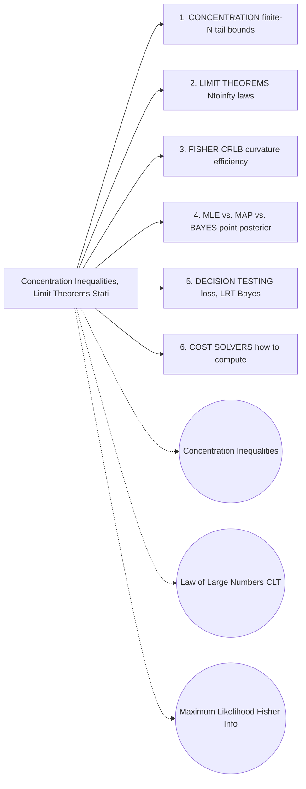

# Cheatsheet — Concentration Inequalities, Limit Theorems & Statistical Estimation (MLE/MAP)

> [!summary] 10-Second Visual Hook
> Sample means concentrate exponentially; rescaled errors turn Gaussian; priors shrink variance

- **Full Monograph:** [[Concentration Inequalities, Limit Theorems & Statistical Estimation (MLE - MAP)]]
- **Sub-Topic MOC:** [[ST 01 - Probability Spaces, Gaussians & Statistical Estimation]]
- **Atomic Concepts:** [[Concentration Inequalities]], [[Law of Large Numbers & CLT]], [[Maximum Likelihood & Fisher Info]]

## Interactive Mindmap Overview

## Branch Summary & Key Equations

- **1. CONCENTRATION — finite-$N$ tail bounds**
- **2. LIMIT THEOREMS — $N\to\infty$ laws**
- **3. FISHER & CRLB — curvature & efficiency**
  $$
  \boldsymbol{F}(\theta)=\mathrm{Cov}_\theta[\boldsymbol{s}]=-\mathbb{E}_\theta[\nabla^2_\theta\log p(X\mid\theta)]
  $$
- **4. MLE vs. MAP vs. BAYES — point & posterior**
- **5. DECISION & TESTING — loss, LRT & Bayes**
- **6. COST & SOLVERS — how to compute**

## Related Sources

[[Source - Introduction-PROBABILITY-for-DATA-SCIENCE]], [[Source - Machine Learning co ban]], [[Source - Probabilistic Machine Learning]]
