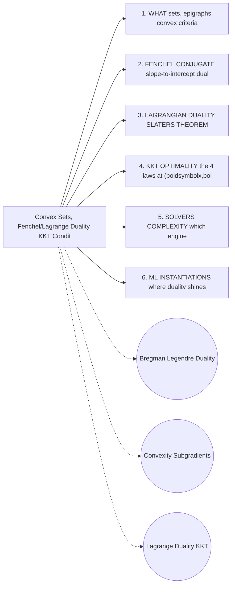

# Cheatsheet — Convex Sets, Fenchel/Lagrange Duality & KKT Conditions

> [!summary] 10-Second Visual Hook
> Epigraph tangents dualize functions; active outward normals balance the objective gradient

- **Full Monograph:** [[Convex Sets, Fenchel - Lagrange Duality & KKT Conditions]]
- **Sub-Topic MOC:** [[ST 01 - Convex Duality & Deterministic Gradient Descent Theory]]
- **Atomic Concepts:** [[Bregman & Legendre Duality]], [[Convexity & Subgradients]], [[Lagrange Duality & KKT]]

## Interactive Mindmap Overview

## Branch Summary & Key Equations

- **1. WHAT — sets, epigraphs & convex criteria**
  $$
  f(\theta\boldsymbol{x}+(1-\theta)\boldsymbol{y})\le \theta f(\boldsymbol{x})+(1-\theta)f(\boldsymbol{y})
  $$
- **2. FENCHEL CONJUGATE — slope-to-intercept dual**
  $$
  f^*(\boldsymbol{y})=\sup_{\boldsymbol{x}\in\operatorname{dom}f}\bigl(\langle \boldsymbol{y}, \boldsymbol{x} \rangle-f(\boldsymbol{x})\bigr)\quad\text{(always convex!)}
  $$
- **3. LAGRANGIAN DUALITY & SLATER'S THEOREM**
  $$
  L(\boldsymbol{x},\boldsymbol{\lambda},\boldsymbol{\nu})=f_0(\boldsymbol{x})+\boldsymbol{\lambda}^{\top}\boldsymbol{f}(\boldsymbol{x})+\boldsymbol{\nu}^{\top}\boldsymbol{h}(\boldsymbol{x}),  \boldsymbol{\lambda}\succeq\boldsymbol{0}
  $$
- **4. KKT OPTIMALITY — the 4 laws at (\boldsymbol{x}^*,\boldsymbol{\lambda}^*,\boldsymbol{\nu}^*)**
  $$
  -\nabla f_0(\boldsymbol{x}^*)=\sum_{i=1}^m\lambda_i^*\nabla f_i(\boldsymbol{x}^*)+\sum_{j=1}^p\nu_j^*\nabla h_j(\boldsymbol{x}^*)
  $$
- **5. SOLVERS & COMPLEXITY — which engine?**
- **6. ML INSTANTIATIONS — where duality shines**

## Related Sources

[[Source - Deep Learning]], [[Source - Foundations]], [[Source - Machine Learning co ban]], [[Source - Mathematics for Machine Learning]], [[Source - Probabilistic Machine Learning]]
