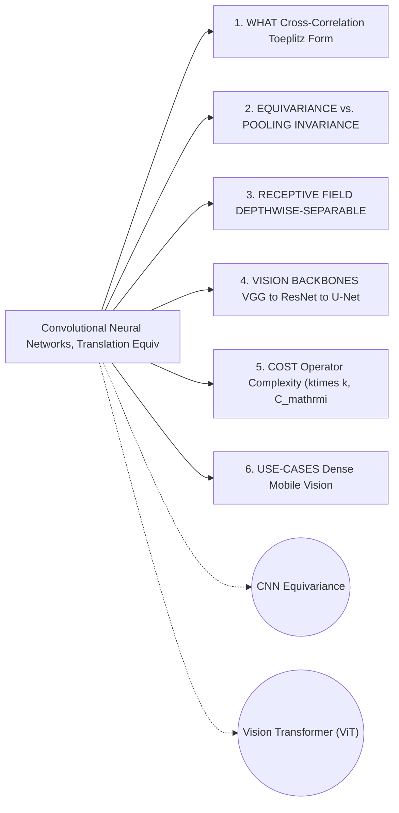

# Cheatsheet — Convolutional Neural Networks, Translation Equivariance & Vision Backbones

> [!summary] 10-Second Visual Hook
> Local Toeplitz weight sharing + translation equivariance = shift the input $\Leftrightarrow$ shift the feature map

- **Full Monograph:** [[Convolutional Neural Networks, Translation Equivariance & Vision Backbones]]
- **Sub-Topic MOC:** [[ST 03 - Convolutional Networks & Graph Neural Networks]]
- **Atomic Concepts:** [[CNN & Equivariance]], [[Vision Transformer (ViT)]]

## Interactive Mindmap Overview

## Branch Summary & Key Equations

- **1. WHAT — Cross-Correlation & Toeplitz Form**
  $$
  H_{\mathrm{out}}=\bigl\lfloor(H+2p-d(k-1)-1)/s\bigr\rfloor+1
  $$
- **2. EQUIVARIANCE vs. POOLING INVARIANCE**
- **3. RECEPTIVE FIELD & DEPTHWISE-SEPARABLE**
  $$
  R_l = R_{l-1} + d_l(k_l-1)\prod_{i=1}^{l-1}s_i
  $$
- **4. VISION BACKBONES — VGG \to ResNet \to U-Net**
- **5. COST — Operator Complexity (k\times k,  C_{\mathrm{in}}\to C_{\mathrm{out}})**
- **6. USE-CASES — Dense & Mobile Vision**

## Related Sources

[[Source - Deep Learning]], [[Source - Foundations]], [[Source - Probabilistic Machine Learning]], [[Source - Understanding Deep Learning]]
