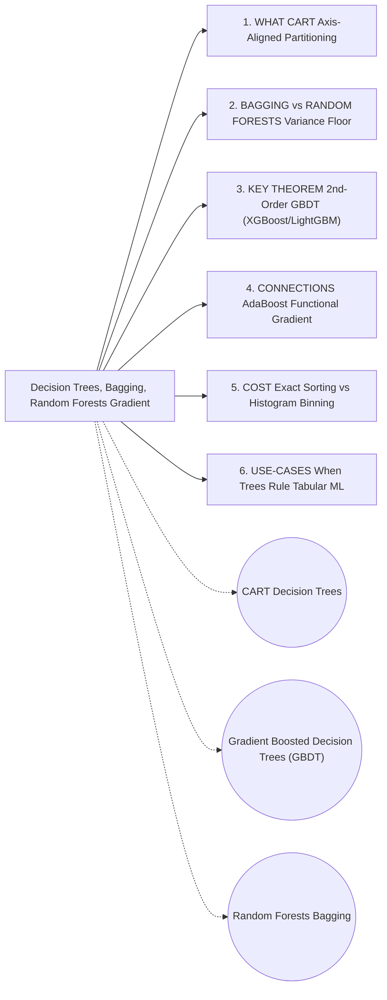

# Cheatsheet — Decision Trees, Bagging, Random Forests & Gradient Boosting

> [!summary] 10-Second Visual Hook
> CART cuts axis-aligned boxes; Bagging & RF average parallel trees to cut $\mathrm{Var}$; Boosting adds sequential trees on $(-g_i, h_i)$ to cut $\mathrm{Bias}$

- **Full Monograph:** [[Decision Trees, Bagging, Random Forests & Gradient Boosting]]
- **Sub-Topic MOC:** [[ST 02 - Kernel Methods, Support Vector Machines & Tree Ensembles]]
- **Atomic Concepts:** [[CART Decision Trees]], [[Gradient Boosted Decision Trees (GBDT)]], [[Random Forests & Bagging]]

## Interactive Mindmap Overview

## Branch Summary & Key Equations

- **1. WHAT — CART Axis-Aligned Partitioning**
  $$
  F_m(\boldsymbol{x})=\sum_{j=1}^{J_m}w_{jm} \mathbb I(\boldsymbol{x}\in R_{jm})
  $$
- **2. BAGGING vs RANDOM FORESTS — Variance Floor**
  $$
  \mathrm{Var}\!\left(\frac{1}{B}\sum_{b=1}^B F_b(\boldsymbol{x})\right)=\rho\sigma^2+\frac{1-\rho}{B}\sigma^2\xrightarrow{B\to\infty}\rho\sigma^2
  $$
- **3. KEY THEOREM — 2nd-Order GBDT (XGBoost/LightGBM)**
  $$
  \tilde{\mathcal L}^{(m)}=\sum_{j=1}^J\!\left[G_{jm}w_j+\frac{1}{2}(H_{jm}+\lambda)w_j^2\right]+\gamma J
  $$
- **4. CONNECTIONS — AdaBoost & Functional Gradient**
  $$
  \beta_m=\tfrac{1}{2}\log\frac{1-\mathrm{err}_m}{\mathrm{err}_m},\quad \omega_{i,m+1}\propto\omega_{i,m}e^{2\beta_m\mathbb I(\tilde y_i\ne F_m(\boldsymbol{x}_i))}
  $$
- **5. COST — Exact Sorting vs Histogram Binning**
- **6. USE-CASES — When Trees Rule Tabular ML**

## Related Sources

[[Source - Deep Learning]], [[Source - Designing Machine Learning Systems]], [[Source - Probabilistic Machine Learning]]
