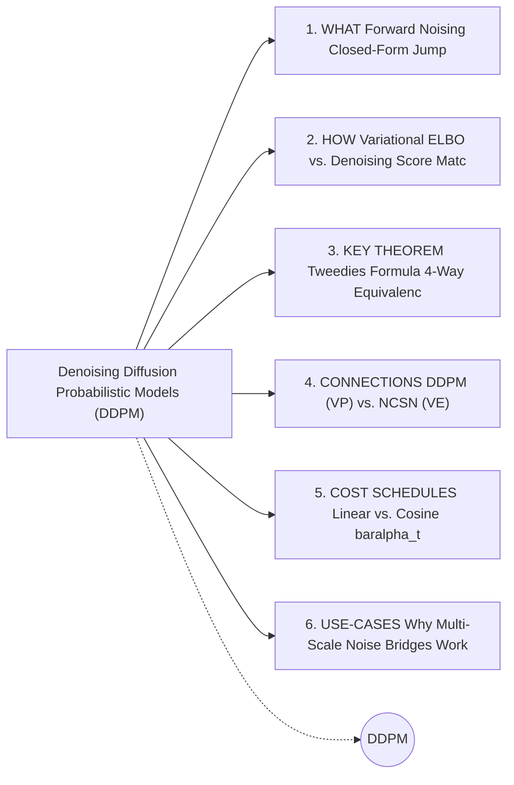

# Cheatsheet — Denoising Diffusion Probabilistic Models (DDPM) & Noise-Conditional Score Networks

> [!summary] 10-Second Visual Hook
> Destroy data into Gaussian noise in closed form; invert the bridge by predicting noise or score

- **Full Monograph:** [[Denoising Diffusion Probabilistic Models (DDPM) & Noise-Conditional Score Networks]]
- **Sub-Topic MOC:** [[ST 04 - DDPM, NCSN, Score SDEs & Flow Matching]]
- **Atomic Concepts:** [[DDPM]]

## Interactive Mindmap Overview

## Branch Summary & Key Equations

- **1. WHAT — Forward Noising & Closed-Form Jump**
  $$
  q(\boldsymbol{x}_t\mid\boldsymbol{x}_0)=\mathcal{N}\!\bigl(\sqrt{\bar\alpha_t}\boldsymbol{x}_0, (1-\bar\alpha_t)\boldsymbol{I}\bigr)
  $$
- **2. HOW — Variational ELBO vs. Denoising Score Matching**
  $$
  \mathcal L_{\mathrm{simple}}(\theta)=\mathbb{E}_{t,\boldsymbol{x}_0,\boldsymbol\epsilon}\!\Bigl[\lVert \boldsymbol\epsilon-\boldsymbol\epsilon_\theta(\sqrt{\bar\alpha_t}\boldsymbol{x}_0+\sqrt{1-\bar\alpha_t}\boldsymbol\epsilon, t) \rVert_2^2\Bigr]
  $$
- **3. KEY THEOREM — Tweedie's Formula & 4-Way Equivalence**
  $$
  \nabla_{\boldsymbol{x}_t}\log q_t(\boldsymbol{x}_t)=-\frac{\mathbb{E}[\boldsymbol\epsilon\mid\boldsymbol{x}_t]}{\sqrt{1-\bar\alpha_t}}=\frac{\sqrt{\bar\alpha_t}\mathbb{E}[\boldsymbol{x}_0\mid\boldsymbol{x}_t]-\boldsymbol{x}_t}{1-\bar\alpha_t}
  $$
- **4. CONNECTIONS — DDPM (VP) vs. NCSN (VE)**
- **5. COST & SCHEDULES — Linear vs. Cosine $\bar\alpha_t$**
- **6. USE-CASES — Why Multi-Scale Noise Bridges Work**

## Related Sources

[[Source - Foundations]], [[Source - Probabilistic Machine Learning]], [[Source - The Principles of Diffusion Models]], [[Source - Tutorial on Diffusion Models for Imaging and Vision]], [[Source - Understanding Deep Learning]]
