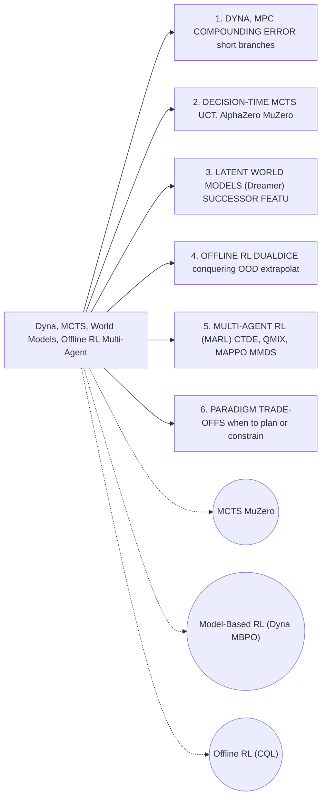

# Cheatsheet — Dyna, MCTS, World Models, Offline RL & Multi-Agent Reinforcement Learning

> [!summary] 10-Second Visual Hook
> Simulate short branches or latent rollouts; regularize against out-of-distribution actions and opponent shift

- **Full Monograph:** [[Dyna, MCTS, World Models, Offline RL & Multi-Agent Reinforcement Learning]]
- **Sub-Topic MOC:** [[ST 06 - Policy Gradients, Actor-Critic, Model-Based RL & MARL]]
- **Atomic Concepts:** [[MCTS & MuZero]], [[Model-Based RL (Dyna & MBPO)]], [[Offline RL (CQL)]]

## Interactive Mindmap Overview

## Branch Summary & Key Equations

- **1. DYNA, MPC & COMPOUNDING ERROR — short branches**
  $$
  \lvert J_{\hat{\mathcal{M}}}(\pi)-J_{\mathcal{M}}(\pi) \rvert \le \frac{2R_{\max}}{(1-\gamma)^2}\!\left[\epsilon_\pi+\frac{\gamma}{1-\gamma}\epsilon_m\right]
  $$
- **2. DECISION-TIME MCTS — UCT, AlphaZero & MuZero**
  $$
  a_t = \arg\max_{a}\!\left[Q(s,a) + c_{\mathrm{puct}} P_\theta(a\mid s)\frac{\sqrt{N(s)}}{1+N(s,a)}\right]
  $$
- **3. LATENT WORLD MODELS (Dreamer) & SUCCESSOR FEATURES**
  $$
  \mathcal{L}_{\mathrm{WM}} = \sum_{t=1}^T \Big(-\beta_o\mathbb{E}_q\big[\ln D(o_t\mid z_t,h_t)\big] + \beta_zD_{\mathrm{KL}}(E(z_t\mid h_t,o_t) \parallel P(\hat{z}_t\mid h_t))\Big)
  $$
- **4. OFFLINE RL & DUALDICE — conquering OOD extrapolation**
  $$
  \mathcal{L}_{\mathrm{CQL}}(w)=\alpha\Big(\mathbb{E}_{s\sim\mathcal{D},a\sim\mu}[Q_w]-\mathbb{E}_{(s,a)\sim\mathcal{D}}[Q_w]+\mathcal{R}(\mu)\Big)+\tfrac{1}{2}\mathcal{E}(B,w)
  $$
- **5. MULTI-AGENT RL (MARL) — CTDE, QMIX, MAPPO & MMDS**
  $$
  \arg\max_{\boldsymbol{a}} Q_{\mathrm{tot}}(\boldsymbol{h}_t,c_t,\boldsymbol{a}) = \big(\arg\max_{a^1} Q_1(h_t^1,a^1),\dots,\arg\max_{a^n} Q_n(h_t^n,a^n)\big)
  $$
- **6. PARADIGM TRADE-OFFS — when to plan or constrain**

## Related Sources

[[Source - Francis Bach]], [[Source - Probabilistic Machine Learning]], [[Source - Reinforcement Learning - An Overview]]
