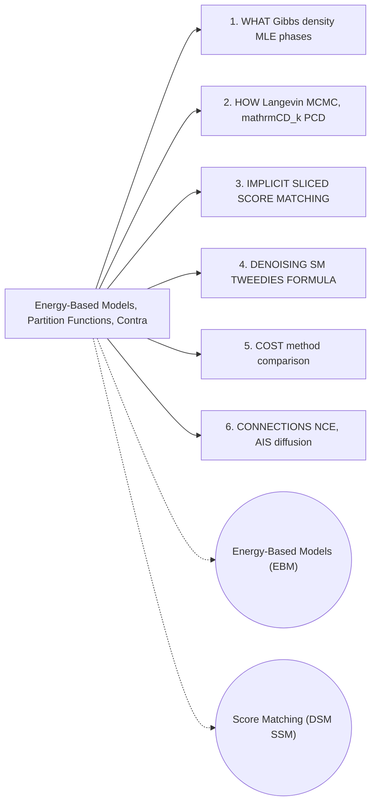

# Cheatsheet — Energy-Based Models, Partition Functions, Contrastive Divergence & Score Matching

> [!summary] 10-Second Visual Hook
> Carve an energy landscape $E_\theta(\boldsymbol{x})$ with low valleys on data; sample or train via Langevin dynamics and $Z_\theta$-free Stein scores

- **Full Monograph:** [[Energy-Based Models, Partition Functions, Contrastive Divergence & Score Matching]]
- **Sub-Topic MOC:** [[ST 04 - Energy-Based Models, Score Matching & Adversarial Networks]]
- **Atomic Concepts:** [[Energy-Based Models (EBM)]], [[Score Matching (DSM & SSM)]]

## Interactive Mindmap Overview

## Branch Summary & Key Equations

- **1. WHAT — Gibbs density & MLE phases**
  $$
  p_\theta(\boldsymbol{x})=\frac{\exp(-E_\theta(\boldsymbol{x}))}{Z_\theta},  Z_\theta=\int_{\mathbb{R}^D}\exp(-E_\theta(\boldsymbol{x})) \mathrm{d}\boldsymbol{x}
  $$
- **2. HOW — Langevin MCMC, $\mathrm{CD}_k$ & PCD**
  $$
  \boldsymbol{x}_{k+1}=\boldsymbol{x}_k-\frac{\epsilon^2}{2}\nabla_{\boldsymbol{x}}E_\theta(\boldsymbol{x}_k)+\epsilon\boldsymbol{z}_k
  $$
- **3. IMPLICIT & SLICED SCORE MATCHING**
  $$
  D_F(p_{\mathcal D}\|p_\theta)=\frac{1}{2}\mathbb{E}_{p_{\mathcal D}}\!\bigl[\lVert \boldsymbol{s}_\theta(\boldsymbol{x})-\nabla_{\boldsymbol{x}}\log p_{\mathcal D}(\boldsymbol{x}) \rVert_2^2\bigr]
  $$
- **4. DENOISING SM & TWEEDIE'S FORMULA**
  $$
  J_{\mathrm{DSM}}(\theta;\sigma)=\frac{1}{2}\mathbb{E}_{\boldsymbol{x},\boldsymbol{\epsilon}}\!\left[\lVert \boldsymbol{s}_\theta(\boldsymbol{x}+\sigma\boldsymbol{\epsilon})+\frac{\boldsymbol{\epsilon}}{\sigma} \rVert_2^2\right]
  $$
- **5. COST — method comparison**
- **6. CONNECTIONS — NCE, AIS & diffusion**

## Related Sources

[[Source - Deep Learning]], [[Source - Probabilistic Machine Learning]], [[Source - The Principles of Diffusion Models]], [[Source - Tutorial on Diffusion Models for Imaging and Vision]]
