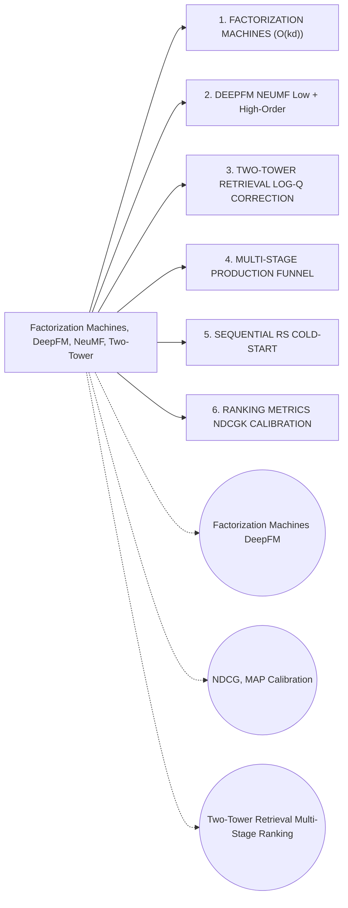

# Cheatsheet — Factorization Machines, DeepFM, NeuMF, Two-Tower Retrieval & Multi-Stage Ranking

> [!summary] 10-Second Visual Hook
> Compute $O(kd)$ pairwise crosses with FM/DeepFM, retrieve $10^7\to 10^3$ via Two-Tower ANN, and rank with calibrated CTR

- **Full Monograph:** [[Factorization Machines, DeepFM, NeuMF, Two-Tower Retrieval & Multi-Stage Ranking]]
- **Sub-Topic MOC:** [[ST 07 - Deep CTR Models, Two-Tower Retrieval & Production Ranking Pipelines]]
- **Atomic Concepts:** [[Factorization Machines & DeepFM]], [[NDCG, MAP & Calibration]], [[Two-Tower Retrieval & Multi-Stage Ranking]]

## Interactive Mindmap Overview

## Branch Summary & Key Equations

- **1. FACTORIZATION MACHINES (O(kd))**
  $$
  \hat y_{\mathrm{FM}}=w_0+\sum_i w_i x_i + \frac{1}{2}\sum_{f=1}^k\Big[\big(\sum_i v_{i,f}x_i\big)^2-\sum_i v_{i,f}^2 x_i^2\Big]
  $$
- **2. DEEPFM & NEUMF — Low + High-Order**
  $$
  \hat y_{\mathrm{DeepFM}} = \sigma\bigl(y_{\mathrm{FM}}(\boldsymbol{x}) + y_{\mathrm{DNN}}(\boldsymbol{e})\bigr)
  $$
- **3. TWO-TOWER RETRIEVAL & LOG-Q CORRECTION**
  $$
  s(u,i)=\frac{\langle u(\boldsymbol{x}_u), v(\boldsymbol{x}_i) \rangle}{\tau},\quad s_{\mathrm{corr}}(u,j)=s(u,j)-\log Q(j)
  $$
- **4. MULTI-STAGE PRODUCTION FUNNEL**
- **5. SEQUENTIAL RS & COLD-START**
- **6. RANKING METRICS — NDCG@K & CALIBRATION**
  $$
  \mathrm{DCG}@K=\sum_{r=1}^K \frac{2^{\mathrm{rel}_r}-1}{\log_2(r+1)},\qquad \mathrm{NDCG}@K=\frac{\mathrm{DCG}@K}{\mathrm{IDCG}@K}
  $$

## Related Sources

[[Source - Designing Machine Learning Systems]], [[Source - Dive into Deep Learning]], [[Source - Probabilistic Machine Learning]]
