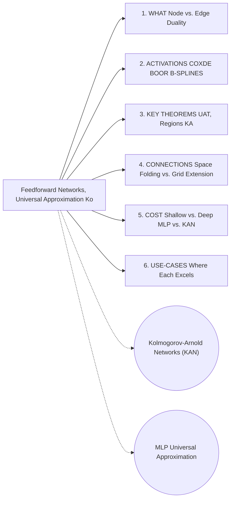

# Cheatsheet — Feedforward Networks, Universal Approximation & Kolmogorov-Arnold Networks (KAN)

> [!summary] 10-Second Visual Hook
> MLPs fold input space with fixed node hinges; KANs bend graph edges with learnable B-splines

- **Full Monograph:** [[Feedforward Networks, Universal Approximation & Kolmogorov-Arnold Networks (KAN)]]
- **Sub-Topic MOC:** [[ST 03 - Feedforward Networks, Normalization, Residuals & KANs]]
- **Atomic Concepts:** [[Kolmogorov-Arnold Networks (KAN)]], [[MLP & Universal Approximation]]

## Interactive Mindmap Overview

## Branch Summary & Key Equations

- **1. WHAT — Node vs. Edge Duality**
- **2. ACTIVATIONS & COX–DE BOOR B-SPLINES**
- **3. KEY THEOREMS — UAT, Regions & K–A**
- **4. CONNECTIONS — Space Folding vs. Grid Extension**
- **5. COST — Shallow vs. Deep MLP vs. KAN**
- **6. USE-CASES — Where Each Excels**

## Related Sources

[[Source - Deep Learning]], [[Source - Foundations]], [[Source - Math behind KAN]], [[Source - Probabilistic Machine Learning]], [[Source - Understanding Deep Learning]]
