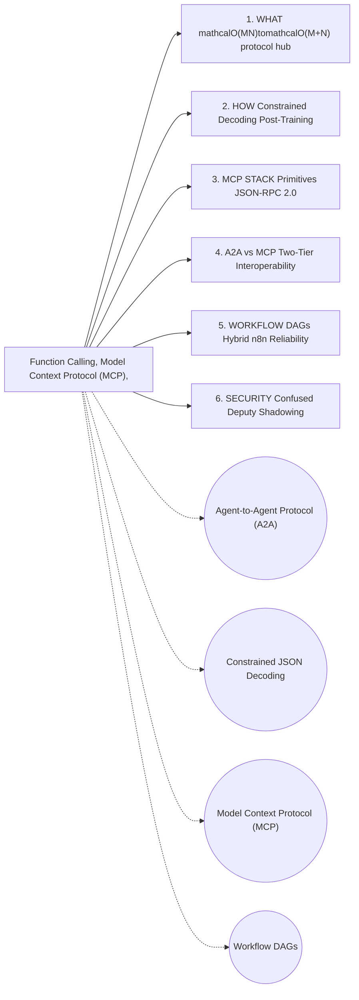

# Cheatsheet — Function Calling, Model Context Protocol (MCP), A2A Interoperability & Workflow Automation

> [!summary] 10-Second Visual Hook
> Collapse $\mathcal{O}(M\cdot N)$ glue code into $\mathcal{O}(M+N)$ protocol hubs: MCP vertically for tools, A2A horizontally for peer agents

- **Full Monograph:** [[Function Calling, Model Context Protocol (MCP), A2A Interoperability & Workflow Automation]]
- **Sub-Topic MOC:** [[ST 07 - RAG, Context Engineering, Memory & Tool - Agent Protocols]]
- **Atomic Concepts:** [[Agent-to-Agent Protocol (A2A)]], [[Constrained JSON Decoding]], [[Model Context Protocol (MCP)]], [[Workflow DAGs]]

## Interactive Mindmap Overview

## Branch Summary & Key Equations

- **1. WHAT — $\mathcal{O}(MN)\to\mathcal{O}(M+N)$ protocol hub**
  $$
  C_{\text{bespoke}}=\mathcal{O}(MN) \longrightarrow C_{\text{proto}}=\mathcal{O}(M+N)
  $$
- **2. HOW — Constrained Decoding & Post-Training**
- **3. MCP STACK — Primitives & JSON-RPC 2.0**
- **4. A2A vs MCP — Two-Tier Interoperability**
- **5. WORKFLOW DAGs — Hybrid n8n Reliability**
  $$
  P_{\text{succ}}=(1-\epsilon_{\text{det}})^{L_{\text{det}}}\prod_{j=1}^{L_{\text{agent}}}\bigl(1-p_{\text{fail},j}^{ r_j+1}(1-q_{\text{fb},j})\bigr)
  $$
- **6. SECURITY — Confused Deputy & Shadowing**

## Related Sources

[[Source - Agent Tools]], [[Source - MCP book]], [[Source - Prototype to]], [[Source - Reinforcement Learning from Human Feedback]], [[Source - The Ultimate n8n Starter Kit (2025)]]
