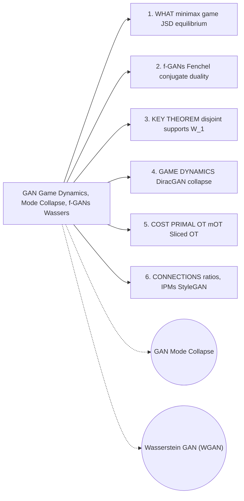

# Cheatsheet — GAN Game Dynamics, Mode Collapse, f-GANs & Wasserstein/OT-GANs

> [!summary] 10-Second Visual Hook
> Push latent noise through a generator $G_\theta$; replace saturating density-ratio critics with $1$-Lipschitz Wasserstein or primal OT distances

- **Full Monograph:** [[GAN Game Dynamics, Mode Collapse, f-GANs & Wasserstein - OT-GANs]]
- **Sub-Topic MOC:** [[ST 04 - Energy-Based Models, Score Matching & Adversarial Networks]]
- **Atomic Concepts:** [[GAN & Mode Collapse]], [[Wasserstein GAN (WGAN)]]

## Interactive Mindmap Overview

## Branch Summary & Key Equations

- **1. WHAT — minimax game & JSD equilibrium**
  $$
  \min_\theta\max_\phi V(\phi,\theta)=\mathbb{E}_{p_{\mathrm{data}}}[\log D_\phi(\boldsymbol{x})]+\mathbb{E}_{p_Z}[\log(1-D_\phi(G_\theta(\boldsymbol{z})))]
  $$
- **2. f-GANs — Fenchel conjugate duality**
  $$
  D_f(p_{\mathrm{data}}\|q_\theta)\ge\sup_{T_\phi}\Bigl\{\mathbb{E}_{\boldsymbol{x}\sim p_{\mathrm{data}}}[T_\phi(\boldsymbol{x})]-\mathbb{E}_{\tilde{\boldsymbol{x}}\sim q_\theta}[f^\dagger(T_\phi(\tilde{\boldsymbol{x}}))]\Bigr\}
  $$
- **3. KEY THEOREM — disjoint supports & W_1**
  $$
  W_{1}(p_{\mathrm{data}}, q_\theta)=\sup_{\lVert f \rVert_{\mathrm{Lip}}\le 1}\bigl\{\mathbb{E}_{p_{\mathrm{data}}}[f(\boldsymbol{x})]-\mathbb{E}_{q_\theta}[f(\tilde{\boldsymbol{x}})]\bigr\}
  $$
- **4. GAME DYNAMICS — DiracGAN & collapse**
  $$
  \boldsymbol{J}(0,0)=\begin{bmatrix}0&\ell'(0)\\-\ell'(0)&0\end{bmatrix},\quad \lambda_\pm=\pm i\ell'(0)
  $$
- **5. COST & PRIMAL OT — mOT & Sliced OT**
- **6. CONNECTIONS — ratios, IPMs & StyleGAN**

## Related Sources

[[Source - Foundations]], [[Source - Optimal Transport in Large-Scale]], [[Source - Probabilistic Machine Learning]], [[Source - Understanding Deep Learning]]
