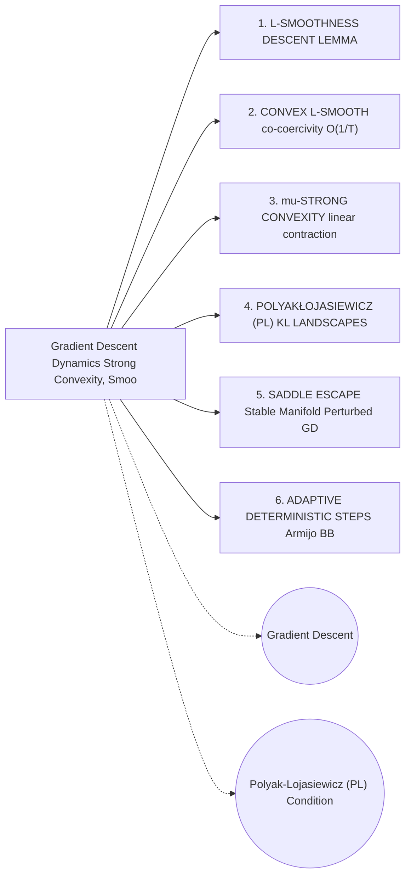

# Cheatsheet — Gradient Descent Dynamics: Strong Convexity, Smoothness, PL Condition & Saddle Escape

> [!summary] 10-Second Visual Hook
> $L$-smoothness caps the step size; $\mu$-strong convexity or $\mu$-PL turns $O(1/T)$ crawl into $(1-\mu/L)^T$ contraction

- **Full Monograph:** [[Gradient Descent Dynamics - Strong Convexity, Smoothness, PL Condition & Saddle Escape]]
- **Sub-Topic MOC:** [[ST 01 - Convex Duality & Deterministic Gradient Descent Theory]]
- **Atomic Concepts:** [[Gradient Descent]], [[Polyak-Lojasiewicz (PL) Condition]]

## Interactive Mindmap Overview

## Branch Summary & Key Equations

- **1. $L$-SMOOTHNESS & DESCENT LEMMA**
  $$
  \lVert \nabla f(\boldsymbol{y})-\nabla f(\boldsymbol{x}) \rVert_2\le L\lVert \boldsymbol{y}-\boldsymbol{x} \rVert_2
  $$
- **2. CONVEX $L$-SMOOTH — co-coercivity & $O(1/T)$**
  $$
  \langle \nabla f(\boldsymbol{y})-\nabla f(\boldsymbol{x}), \boldsymbol{y}-\boldsymbol{x} \rangle\ge\frac{1}{L}\lVert \nabla f(\boldsymbol{y})-\nabla f(\boldsymbol{x}) \rVert_2^2
  $$
- **3. $\mu$-STRONG CONVEXITY — linear contraction**
  $$
  \mu\boldsymbol{I}_d\preceq\nabla^2 f(\boldsymbol{x})\preceq L\boldsymbol{I}_d,  \kappa=\frac{L}{\mu}\ge 1
  $$
- **4. POLYAK–ŁOJASIEWICZ (PL) & KL LANDSCAPES**
  $$
  \tfrac{1}{2}\lVert \nabla f(\boldsymbol{x}) \rVert_2^2\ge\mu\bigl(f(\boldsymbol{x})-f^*\bigr) (\text{no convexity needed!})
  $$
- **5. SADDLE ESCAPE — Stable Manifold & Perturbed GD**
- **6. ADAPTIVE DETERMINISTIC STEPS — Armijo & BB**

## Related Sources

[[Source - Fall 2022]], [[Source - Foundations]], [[Source - Handbook of Convergence Theorems]], [[Source - Mathematics for Machine Learning]], [[Source - Probabilistic Machine Learning]]
