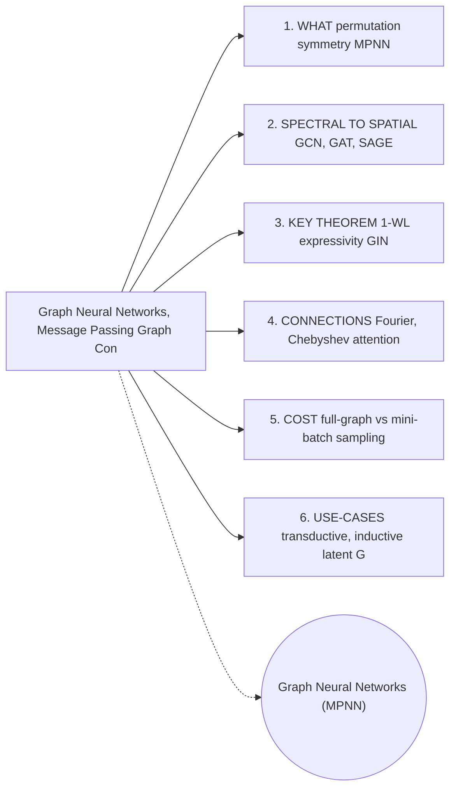

# Cheatsheet — Graph Neural Networks, Message Passing & Graph Convolutional Architectures

> [!summary] 10-Second Visual Hook
> Aggregate $\cdot$ Transform $\cdot$ Update on $G=(\mathcal V,\mathcal E)$ with built-in permutation equivariance

- **Full Monograph:** [[Graph Neural Networks, Message Passing & Graph Convolutional Architectures]]
- **Sub-Topic MOC:** [[ST 03 - Convolutional Networks & Graph Neural Networks]]
- **Atomic Concepts:** [[Graph Neural Networks (MPNN)]]

## Interactive Mindmap Overview

## Branch Summary & Key Equations

- **1. WHAT — permutation symmetry & MPNN**
  $$
  \boldsymbol{m}_i^{(\ell+1)} = \bigoplus_{j\in\mathcal N(i)} \psi_{\mathrm{msg}}\!\bigl(\boldsymbol{h}_i^{(\ell)},\boldsymbol{h}_j^{(\ell)},\boldsymbol{e}_{ij}\bigr)
  $$
- **2. SPECTRAL TO SPATIAL — GCN, GAT, SAGE**
- **3. KEY THEOREM — 1-WL expressivity & GIN**
  $$
  \boldsymbol{h}_i^{(\ell+1)} = \mathrm{MLP}^{(\ell)}\!\Bigl((1+\epsilon)\boldsymbol{h}_i^{(\ell)} + \sum_{j\in\mathcal N(i)}\boldsymbol{h}_j^{(\ell)}\Bigr)
  $$
- **4. CONNECTIONS — Fourier, Chebyshev & attention**
- **5. COST — full-graph vs mini-batch sampling**
- **6. USE-CASES — transductive, inductive & latent G**

## Related Sources

[[Source - Foundations]], [[Source - Probabilistic Machine Learning]], [[Source - Understanding Deep Learning]]
