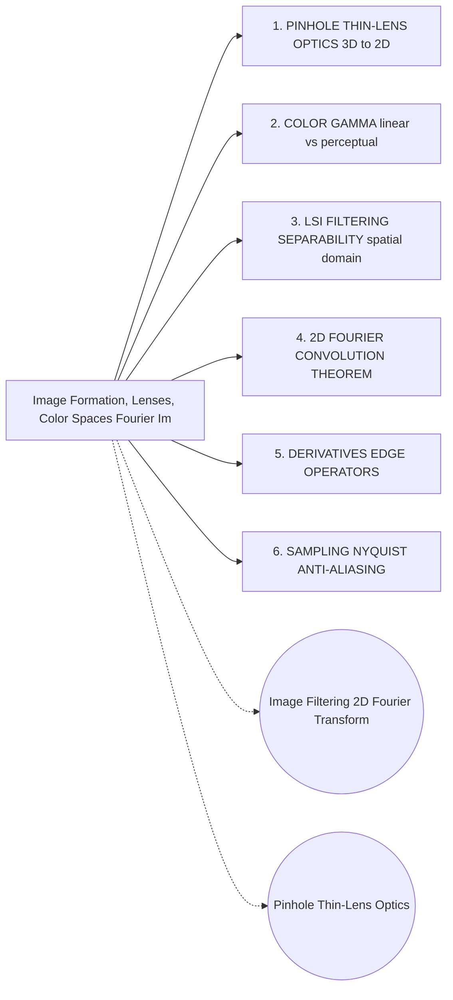

# Cheatsheet — Image Formation, Lenses, Color Spaces & Fourier Image Filtering

> [!summary] 10-Second Visual Hook
> Invert 3D-to-2D projection, separate signal via LSI/Fourier spectra, and band-limit before sampling

- **Full Monograph:** [[Image Formation, Lenses, Color Spaces & Fourier Image Filtering]]
- **Sub-Topic MOC:** [[ST 03 - Image Formation, Fourier Filtering, Pyramids & 3D Geometry]]
- **Atomic Concepts:** [[Image Filtering & 2D Fourier Transform]], [[Pinhole & Thin-Lens Optics]]

## Interactive Mindmap Overview

## Branch Summary & Key Equations

- **1. PINHOLE & THIN-LENS OPTICS — 3D to 2D**
  $$
  x = f\frac{X}{Z},  y = f\frac{Y}{Z},  \frac{1}{z_o}+\frac{1}{z_i}=\frac{1}{f}
  $$
- **2. COLOR & GAMMA — linear vs perceptual**
- **3. LSI FILTERING & SEPARABILITY — spatial domain**
  $$
  (I*h)[y,x]=\sum_{i,j}I[y-i,x-j]h[i,j],  G_\sigma(x,y)=g_\sigma(x)g_\sigma(y)
  $$
- **4. 2D FOURIER & CONVOLUTION THEOREM**
  $$
  \hat I[u,v]=\sum_{y,x}I[y,x]e^{-i2\pi(\frac{ux}{W}+\frac{vy}{H})},  \mathcal{F}\{I*h\}=\hat I\odot\hat h
  $$
- **5. DERIVATIVES & EDGE OPERATORS**
  $$
  \nabla(G_\sigma*I)=(\nabla G_\sigma)*I,  \Delta I = \partial_{xx}I+\partial_{yy}I
  $$
- **6. SAMPLING & NYQUIST ANTI-ALIASING**
  $$
  |u|_{\max} \le f_{\mathrm{Nyq}} = \frac{1}{2\Delta x} \implies \text{low-pass before } \downarrow_s
  $$

## Related Sources

[[Source - Antonio Torralba, Phillip Isola, and William Freeman]], [[Source - Dive into Deep Learning]]
