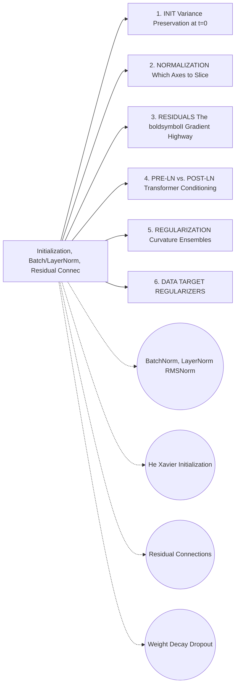

# Cheatsheet — Initialization, Batch/LayerNorm, Residual Connections, Weight Decay & Dropout

> [!summary] 10-Second Visual Hook
> Calibrate variance at $t=0$, standardize features, open an $\boldsymbol{I}$ gradient highway, filter flat directions

- **Full Monograph:** [[Initialization, Batch - LayerNorm, Residual Connections, Weight Decay & Dropout]]
- **Sub-Topic MOC:** [[ST 03 - Feedforward Networks, Normalization, Residuals & KANs]]
- **Atomic Concepts:** [[BatchNorm, LayerNorm & RMSNorm]], [[He & Xavier Initialization]], [[Residual Connections]], [[Weight Decay & Dropout]]

## Interactive Mindmap Overview

## Branch Summary & Key Equations

- **1. INIT — Variance Preservation at $t=0$**
  $$
  \mathrm{Var}(f_i^{(l)})=D_{l-1}\sigma_l^2 \mathbb{E}\bigl[(h_j^{(l-1)})^2\bigr]
  $$
- **2. NORMALIZATION — Which Axes to Slice?**
- **3. RESIDUALS — The $\boldsymbol{I}$ Gradient Highway**
  $$
  \frac{\partial \mathcal{L}}{\partial \boldsymbol{x}^{(l)}}=\frac{\partial \mathcal{L}}{\partial \boldsymbol{x}^{(L)}}\!\left(\boldsymbol{I}+\frac{\partial }{\partial \boldsymbol{x}^{(l)}}\sum_{k=l}^{L-1}\mathcal{F}_k\right)
  $$
- **4. PRE-LN vs. POST-LN — Transformer Conditioning**
- **5. REGULARIZATION — Curvature & Ensembles**
- **6. DATA & TARGET REGULARIZERS**

## Related Sources

[[Source - Build a Large Language Model (From Scratch) (for sam speaks)]], [[Source - Deep Learning]], [[Source - Foundations]], [[Source - Understanding Deep Learning]]
