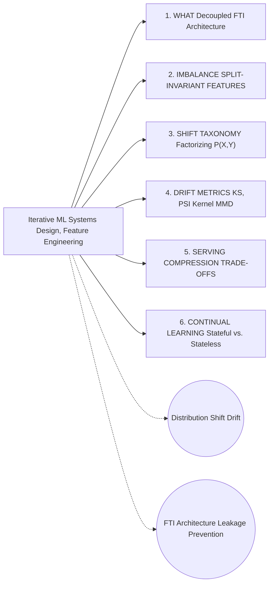

# Cheatsheet — Iterative ML Systems Design, Feature Engineering, Leakage, Distribution Shift & Continual Learning

> [!summary] 10-Second Visual Hook
> Decouple Feature–Training–Inference, enforce split-invariance, detect $P(X,Y)$ shift & retrain continually

- **Full Monograph:** [[Iterative ML Systems Design, Feature Engineering, Leakage, Distribution Shift & Continual Learning]]
- **Sub-Topic MOC:** [[ST 07 - ML Systems Design, Data Pipelines & Distribution Shifts]]
- **Atomic Concepts:** [[Distribution Shift & Drift]], [[FTI Architecture & Leakage Prevention]]

## Interactive Mindmap Overview

## Branch Summary & Key Equations

- **1. WHAT — Decoupled FTI Architecture**
- **2. IMBALANCE & SPLIT-INVARIANT FEATURES**
  $$
  \mathcal{L}_{\mathrm{FL}}(p_t)=-\alpha_t(1-p_t)^\gamma\log(p_t),\quad W_i^{\mathrm{eff}}=\frac{1-\beta}{1-\beta^{N_i}}
  $$
- **3. SHIFT TAXONOMY — Factorizing P(X,Y)**
- **4. DRIFT METRICS — KS, PSI & Kernel MMD**
  $$
  \mathrm{PSI}=\sum_{b=1}^{B}(q_b-p_b)\ln\frac{q_b}{p_b}
  $$
- **5. SERVING & COMPRESSION TRADE-OFFS**
- **6. CONTINUAL LEARNING — Stateful vs. Stateless**

## Related Sources

[[Source - Designing Machine Learning Systems]], [[Source - LLM Engineer’s Handbook]]
