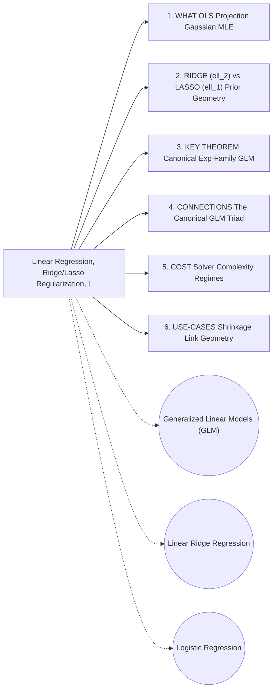

# Cheatsheet — Linear Regression, Ridge/Lasso Regularization, Logistic Regression & GLMs

> [!summary] 10-Second Visual Hook
> One linear predictor $\boldsymbol{\eta}=\boldsymbol{\Phi}\boldsymbol{w}$, three canonical links, one residual-weighted gradient $\boldsymbol{\Phi}^{\top}(\boldsymbol{\mu}-\boldsymbol{y})$

- **Full Monograph:** [[Linear Regression, Ridge - Lasso Regularization, Logistic Regression & GLMs]]
- **Sub-Topic MOC:** [[ST 02 - Linear, Regularized & Generalized Linear Models]]
- **Atomic Concepts:** [[Generalized Linear Models (GLM)]], [[Linear & Ridge Regression]], [[Logistic Regression]]

## Interactive Mindmap Overview

## Branch Summary & Key Equations

- **1. WHAT — OLS Projection & Gaussian MLE**
  $$
  \hat{\boldsymbol{w}}_{\mathrm{MLE}}=(\boldsymbol{\Phi}^{\top}\boldsymbol{\Phi})^{-1}\boldsymbol{\Phi}^{\top}\boldsymbol{y}
  $$
- **2. RIDGE (\ell_2) vs LASSO (\ell_1) — Prior & Geometry**
- **3. KEY THEOREM — Canonical Exp-Family GLM**
  $$
  p(y_n\mid\theta_n,\phi)=h(y_n,\phi)\exp\!\left(\frac{y_n\theta_n-A(\theta_n)}{\phi}\right)
  $$
- **4. CONNECTIONS — The Canonical GLM Triad**
- **5. COST — Solver Complexity & Regimes**
- **6. USE-CASES — Shrinkage & Link Geometry**

## Related Sources

[[Source - Foundations]], [[Source - Introduction-PROBABILITY-for-DATA-SCIENCE]], [[Source - Machine Learning co ban]], [[Source - Mathematics for Machine Learning]], [[Source - Probabilistic Machine Learning]], [[Source - Speech and Language Processing]]
