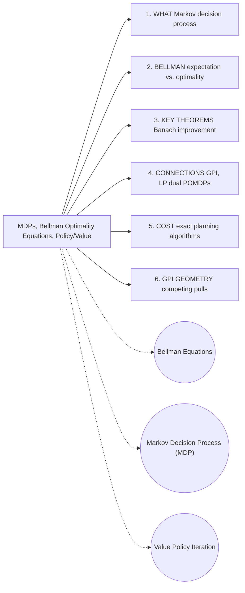

# Cheatsheet — MDPs, Bellman Optimality Equations, Policy/Value Iteration & GPI

> [!summary] 10-Second Visual Hook
> Compress infinite-horizon trees into $V^*(s)$ via $\gamma$-contractions; alternate evaluation and greedy improvement

- **Full Monograph:** [[MDPs, Bellman Optimality Equations, Policy - Value Iteration & GPI]]
- **Sub-Topic MOC:** [[ST 06 - Multi-Armed Bandits, MDPs & Dynamic Programming]]
- **Atomic Concepts:** [[Bellman Equations]], [[Markov Decision Process (MDP)]], [[Value & Policy Iteration]]

## Interactive Mindmap Overview

## Branch Summary & Key Equations

- **1. WHAT — Markov decision process**
  $$
  G_t = \sum_{k=0}^\infty \gamma^k R_{t+k+1} = R_{t+1} + \gamma G_{t+1}
  $$
- **2. BELLMAN — expectation vs. optimality**
- **3. KEY THEOREMS — Banach & improvement**
  $$
  \lVert \mathcal{T}^* U - \mathcal{T}^* V \rVert_\infty \le \gamma\lVert U - V \rVert_\infty
  $$
- **4. CONNECTIONS — GPI, LP dual & POMDPs**
- **5. COST — exact planning algorithms**
- **6. GPI GEOMETRY — competing pulls**

## Related Sources

[[Source - Francis Bach]], [[Source - Probabilistic Machine Learning]], [[Source - Reinforcement Learning - An Overview]], [[Source - Understanding Deep Learning]]
