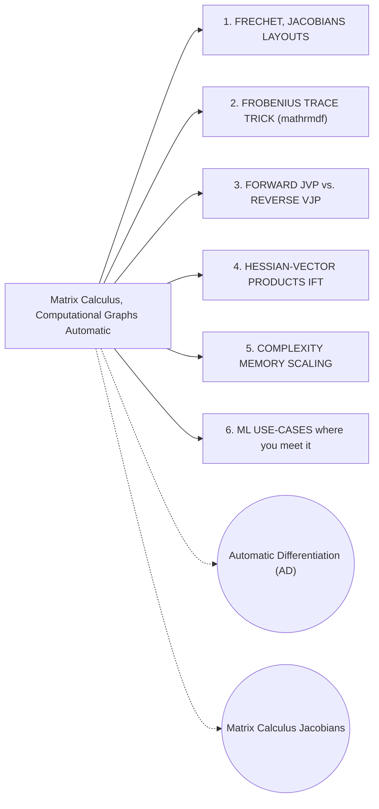

# Cheatsheet — Matrix Calculus, Computational Graphs & Automatic Differentiation

> [!summary] 10-Second Visual Hook
> Chain rule = matrix multiplication; parenthesize right-to-left (JVP) or left-to-right (VJP) to beat the curse of dimensionality

- **Full Monograph:** [[Matrix Calculus, Computational Graphs & Automatic Differentiation]]
- **Sub-Topic MOC:** [[ST 01 - Matrix Calculus, Jacobians & Automatic Differentiation]]
- **Atomic Concepts:** [[Automatic Differentiation (AD)]], [[Matrix Calculus & Jacobians]]

## Interactive Mindmap Overview

## Branch Summary & Key Equations

- **1. FR\'{E}CHET, JACOBIANS & LAYOUTS**
  $$
  \boldsymbol{f}(\boldsymbol{x}+\boldsymbol{h}) = \boldsymbol{f}(\boldsymbol{x}) + \boldsymbol{J}_{\boldsymbol{f}}(\boldsymbol{x})\boldsymbol{h} + o(\lVert \boldsymbol{h} \rVert_2)
  $$
- **2. FROBENIUS TRACE TRICK ($\mathrm{d}f$)**
  $$
  \mathrm{d}f(\boldsymbol{X}) = \mathrm{Tr}\!\big((\nabla_{\boldsymbol{X}} f)^{\top} \mathrm{d}\boldsymbol{X}\big) = \langle \nabla_{\boldsymbol{X}} f, \mathrm{d}\boldsymbol{X} \rangle_F
  $$
- **3. FORWARD JVP vs. REVERSE VJP**
  $$
  \boldsymbol{J}_T(\cdots(\boldsymbol{J}_1\boldsymbol{v}))  \text{vs.}  \boldsymbol{J}_1^{\top}(\cdots(\boldsymbol{J}_T^{\top}\boldsymbol{u}))
  $$
- **4. HESSIAN-VECTOR PRODUCTS & IFT**
  $$
  \nabla^2 f(\boldsymbol{x})\boldsymbol{v} = \nabla_{\boldsymbol{x}}\!\Big(\nabla_{\boldsymbol{x}} f(\boldsymbol{x})^{\top}\mathrm{stopgrad}(\boldsymbol{v})\Big)
  $$
- **5. COMPLEXITY & MEMORY SCALING**
- **6. ML USE-CASES — where you meet it**

## Related Sources

[[Source - Deep Learning]], [[Source - Foundations]], [[Source - Machine Learning co ban]], [[Source - Mathematics for Machine Learning]], [[Source - Probabilistic Machine Learning]]
