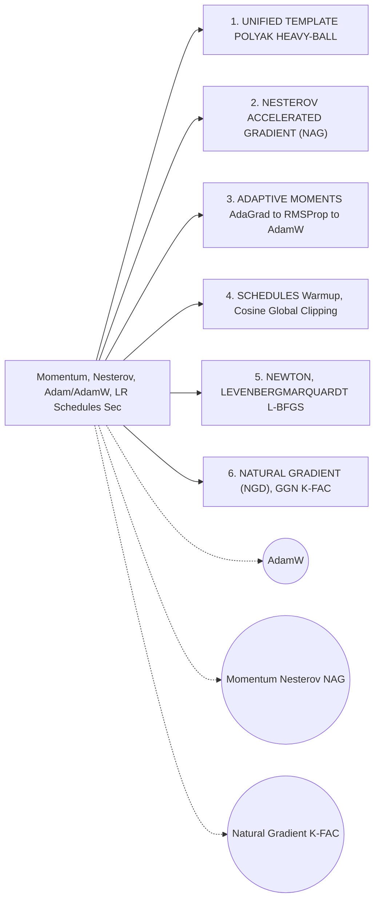

# Cheatsheet — Momentum, Nesterov, Adam/AdamW, LR Schedules & Second-Order / Natural Gradient

> [!summary] 10-Second Visual Hook
> Momentum accelerates $\kappa\to\sqrt\kappa$; adaptive & Fisher preconditioners $\boldsymbol{P}_t^{-1}$ turn eccentric ravines into isotropic spheres

- **Full Monograph:** [[Momentum, Nesterov, Adam - AdamW, LR Schedules & Second-Order - Natural Gradient]]
- **Sub-Topic MOC:** [[ST 01 - Stochastic, Adaptive, Proximal & Second-Order Optimizers]]
- **Atomic Concepts:** [[AdamW]], [[Momentum & Nesterov NAG]], [[Natural Gradient & K-FAC]]

## Interactive Mindmap Overview

## Branch Summary & Key Equations

- **1. UNIFIED TEMPLATE & POLYAK HEAVY-BALL**
  $$
  \boldsymbol{\theta}_t=(1-\eta_t\lambda)\boldsymbol{\theta}_{t-1}-\eta_t\boldsymbol{P}_t^{-1}\boldsymbol{d}_t
  $$
- **2. NESTEROV ACCELERATED GRADIENT (NAG)**
  $$
  \boldsymbol{y}_t=\boldsymbol{x}_t+\beta_t(\boldsymbol{x}_t-\boldsymbol{x}_{t-1}),   \boldsymbol{x}_{t+1}=\boldsymbol{y}_t-\eta_t\nabla f(\boldsymbol{y}_t)
  $$
- **3. ADAPTIVE MOMENTS: AdaGrad \to RMSProp \to AdamW**
  $$
  \hat{\boldsymbol{m}}_t=\frac{\boldsymbol{m}_t}{1-\beta_1^t},\quad \hat{\boldsymbol{v}}_t=\frac{\boldsymbol{v}_t}{1-\beta_2^t},\quad \boldsymbol{\theta}_t=(1-\eta_t\lambda)\boldsymbol{\theta}_{t-1}-\eta_t\frac{\hat{\boldsymbol{m}}_t}{\sqrt{\hat{\boldsymbol{v}}_t}+\epsilon}
  $$
- **4. SCHEDULES — Warmup, Cosine & Global Clipping**
- **5. NEWTON, LEVENBERG–MARQUARDT & L-BFGS**
  $$
  \boldsymbol{C}_{t+1}=\boldsymbol{V}_t^{\top}\boldsymbol{C}_t\boldsymbol{V}_t+\rho_t\boldsymbol{s}_t\boldsymbol{s}_t^{\top},\qquad \boldsymbol{V}_t=\boldsymbol{I}_P-\rho_t\boldsymbol{y}_t\boldsymbol{s}_t^{\top},\quad \rho_t=(\boldsymbol{y}_t^{\top}\boldsymbol{s}_t)^{-1}
  $$
- **6. NATURAL GRADIENT (NGD), GGN & K-FAC**
  $$
  \boldsymbol{F}(\boldsymbol{\theta})=\mathbb{E}_{p(\boldsymbol{x})p_{\boldsymbol{\theta}}(y\mid\boldsymbol{x})}\bigl[\nabla\log p \nabla\log p^{\top}\bigr]\succeq\boldsymbol{0},\qquad \tilde\nabla\mathcal L=\boldsymbol{F}(\boldsymbol{\theta})^{-1}\nabla\mathcal L
  $$

## Related Sources

[[Source - Build a Large Language Model (From Scratch) (for sam speaks)]], [[Source - Deep Learning]], [[Source - Handbook of Convergence Theorems]], [[Source - Machine Learning co ban]], [[Source - Probabilistic Machine Learning]], [[Source - Understanding Deep Learning]]
