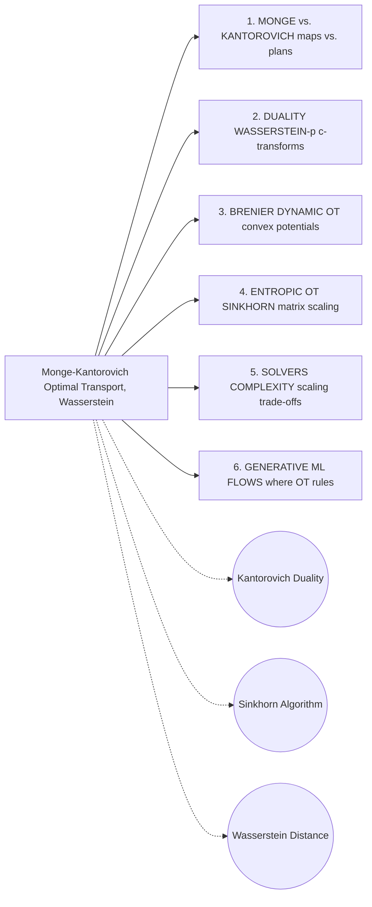

# Cheatsheet — Monge-Kantorovich Optimal Transport, Wasserstein Metrics & Sinkhorn Scaling

> [!summary] 10-Second Visual Hook
> Compare distributions horizontally along ground metrics; regularize with entropy to scale in $O(n^2)$

- **Full Monograph:** [[Monge-Kantorovich Optimal Transport, Wasserstein Metrics & Sinkhorn Scaling]]
- **Sub-Topic MOC:** [[ST 01 - Information Theory, Divergences & Optimal Transport]]
- **Atomic Concepts:** [[Kantorovich Duality]], [[Sinkhorn Algorithm]], [[Wasserstein Distance]]

## Interactive Mindmap Overview

## Branch Summary & Key Equations

- **1. MONGE vs. KANTOROVICH — maps vs. plans**
  $$
  \mathrm{OT}_c(\mu,\nu)=\inf_{\pi\in\Pi(\mu,\nu)}\int c(\boldsymbol{x},\boldsymbol{y}) \mathrm{d}\pi
  $$
- **2. DUALITY & WASSERSTEIN-$p$ — $c$-transforms**
  $$
  \mathrm{OT}_c(\mu,\nu)=\sup_{f(\boldsymbol{x})+g(\boldsymbol{y})\le c}\mathbb{E}_\mu[f]+\mathbb{E}_\nu[g]=\sup_{f\in\mathcal F_c}\mathbb{E}_\mu[f]+\mathbb{E}_\nu[f^c]
  $$
- **3. BRENIER & DYNAMIC OT — convex potentials**
  $$
  T^\star(\boldsymbol{x})=\nabla u(\boldsymbol{x}),  u(\boldsymbol{x})=\tfrac12\lVert \boldsymbol{x} \rVert_2^2-f^\star(\boldsymbol{x}) \text{convex}
  $$
- **4. ENTROPIC OT & SINKHORN — matrix scaling**
  $$
  \mathrm{EOT}_\varepsilon(\mu,\nu)=\inf_{\pi\in\Pi(\mu,\nu)}\langle c, \pi \rangle+\varepsilon D_{\mathrm{KL}}(\pi \parallel \mu\otimes\nu)
  $$
- **5. SOLVERS & COMPLEXITY — scaling trade-offs**
- **6. GENERATIVE ML & FLOWS — where OT rules**

## Related Sources

[[Source - Optimal Transport in Large-Scale]], [[Source - Probabilistic Machine Learning]], [[Source - The Principles of Diffusion Models]]
