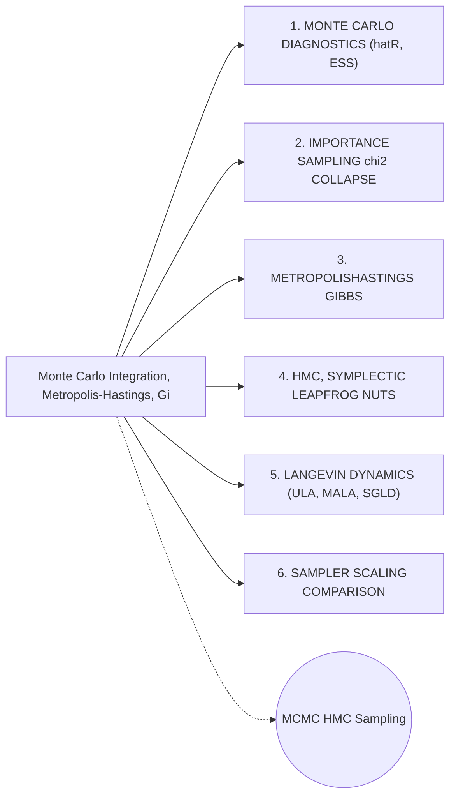

# Cheatsheet — Monte Carlo Integration, Metropolis-Hastings, Gibbs, HMC & Langevin Sampling

> [!summary] 10-Second Visual Hook
> Beat high-dimensional random walks: glide along the typical set with symplectic Hamiltonian flow

- **Full Monograph:** [[Monte Carlo Integration, Metropolis-Hastings, Gibbs, HMC & Langevin Sampling]]
- **Sub-Topic MOC:** [[ST 02 - Graphical Models, Gaussian Processes, Variational Inference & MCMC]]
- **Atomic Concepts:** [[MCMC & HMC Sampling]]

## Interactive Mindmap Overview

## Branch Summary & Key Equations

- **1. MONTE CARLO & DIAGNOSTICS (\hat{R}, ESS)**
  $$
  \hat\mu_S = \frac{1}{S}\sum_{s=1}^S f(\boldsymbol{\theta}^{(s)}),\qquad \mathrm{Var}[\hat\mu_S] = \frac{\sigma^2}{S} \tau_{\mathrm{int}}
  $$
- **2. IMPORTANCE SAMPLING & \chi^2 COLLAPSE**
  $$
  \hat\mu_{\mathrm{SNIS}}=\sum_{s=1}^S W_s f(\boldsymbol{\theta}^{(s)}),\quad \tilde w_s=\frac{\tilde\pi(\boldsymbol{\theta}^{(s)})}{q(\boldsymbol{\theta}^{(s)})}
  $$
- **3. METROPOLIS–HASTINGS & GIBBS**
  $$
  \alpha(\boldsymbol{\theta},\boldsymbol{\theta}') = \min\!\left(1, \frac{\tilde\pi(\boldsymbol{\theta}') q(\boldsymbol{\theta}\mid\boldsymbol{\theta}')}{\tilde\pi(\boldsymbol{\theta}) q(\boldsymbol{\theta}'\mid\boldsymbol{\theta})}\right)
  $$
- **4. HMC, SYMPLECTIC LEAPFROG & NUTS**
  $$
  H(\boldsymbol{\theta},\boldsymbol{r}) = E(\boldsymbol{\theta}) + \tfrac{1}{2}\boldsymbol{r}^{\top}\boldsymbol{M}^{-1}\boldsymbol{r},\qquad E(\boldsymbol{\theta})=-\log\tilde\pi(\boldsymbol{\theta})
  $$
- **5. LANGEVIN DYNAMICS (ULA, MALA, SGLD)**
  $$
  \boldsymbol{\theta}_{t+1} = \boldsymbol{\theta}_t + \epsilon \nabla_{\boldsymbol{\theta}}\log\tilde\pi(\boldsymbol{\theta}_t) + \sqrt{2\epsilon} \boldsymbol{\xi}_t,\quad \boldsymbol{\xi}_t\sim\mathcal{N}(\boldsymbol{0},\boldsymbol{I}_d)
  $$
- **6. SAMPLER SCALING COMPARISON**

## Related Sources

[[Source - Deep Learning]], [[Source - Foundations]], [[Source - Probabilistic Machine Learning]], [[Source - Tutorial on Diffusion Models for Imaging and Vision]]
