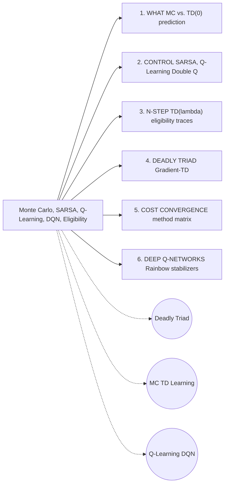

# Cheatsheet — Monte Carlo, SARSA, Q-Learning, DQN, Eligibility Traces & the Deadly Triad

> [!summary] 10-Second Visual Hook
> Bridge 1-step TD bootstrapping and full MC returns via $\mathrm{TD}(\lambda)$; disarm the Deadly Triad with Replay, Target Nets & Double Q

- **Full Monograph:** [[Monte Carlo, SARSA, Q-Learning, DQN, Eligibility Traces & the Deadly Triad]]
- **Sub-Topic MOC:** [[ST 06 - Monte Carlo, Temporal-Difference, DQN & Function Approximation]]
- **Atomic Concepts:** [[Deadly Triad]], [[MC & TD Learning]], [[Q-Learning & DQN]]

## Interactive Mindmap Overview

## Branch Summary & Key Equations

- **1. WHAT — MC vs. TD(0) prediction**
  $$
  \delta_t = R_{t+1} + \gamma V(S_{t+1}) - V(S_t)
  $$
- **2. CONTROL — SARSA, Q-Learning & Double Q**
- **3. N-STEP & TD(\lambda) — eligibility traces**
  $$
  G_t^\lambda = (1-\lambda)\sum_{n=1}^\infty \lambda^{n-1} G_{t:t+n}
  $$
- **4. DEADLY TRIAD & Gradient-TD**
- **5. COST & CONVERGENCE — method matrix**
- **6. DEEP Q-NETWORKS — Rainbow stabilizers**

## Related Sources

[[Source - Francis Bach]], [[Source - Probabilistic Machine Learning]], [[Source - Reinforcement Learning - An Overview]], [[Source - Understanding Deep Learning]]
