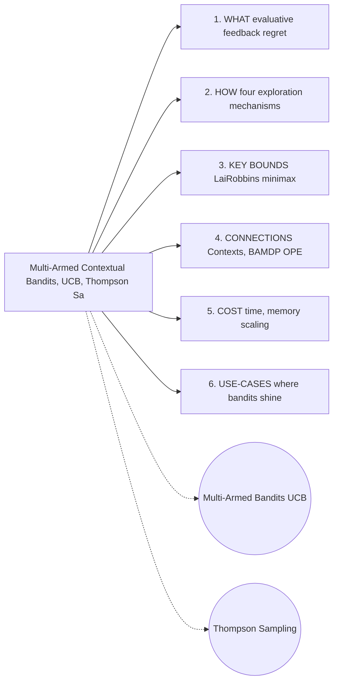

# Cheatsheet — Multi-Armed & Contextual Bandits, UCB, Thompson Sampling & Regret Bounds

> [!summary] 10-Second Visual Hook
> Earn while you learn: trade off immediate reward $\hat{\mu}_t(a)$ against uncertainty bonus $\delta_t(a)$

- **Full Monograph:** [[Multi-Armed & Contextual Bandits, UCB, Thompson Sampling & Regret Bounds]]
- **Sub-Topic MOC:** [[ST 06 - Multi-Armed Bandits, MDPs & Dynamic Programming]]
- **Atomic Concepts:** [[Multi-Armed Bandits & UCB]], [[Thompson Sampling]]

## Interactive Mindmap Overview

## Branch Summary & Key Equations

- **1. WHAT — evaluative feedback & regret**
  $$
  L_T = \sum_{t=1}^T \ell_t = \sum_{a=1}^K \mathbb{E}[N_{T+1}(a)] \Delta_a
  $$
- **2. HOW — four exploration mechanisms**
- **3. KEY BOUNDS — Lai–Robbins & minimax**
  $$
  \liminf_{T\to\infty}\frac{L_T}{\ln T} \ge \sum_{\Delta_a>0}\frac{\Delta_a}{D_{\mathrm{KL}}(p_R(a) \parallel p_R(a^*))}
  $$
- **4. CONNECTIONS — Contexts, BAMDP & OPE**
- **5. COST — time, memory & scaling**
- **6. USE-CASES — where bandits shine**

## Related Sources

[[Source - Francis Bach]], [[Source - Probabilistic Machine Learning]], [[Source - Reinforcement Learning - An Overview]]
