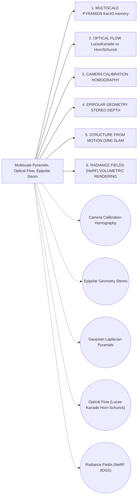

# Cheatsheet — Multiscale Pyramids, Optical Flow, Epipolar Geometry, Stereo & Radiance Fields

> [!summary] 10-Second Visual Hook
> Track motion via coarse-to-fine brightness constancy, triangulate 3D via epipolar geometry, and render continuous radiance

- **Full Monograph:** [[Multiscale Pyramids, Optical Flow, Epipolar Geometry, Stereo & Radiance Fields]]
- **Sub-Topic MOC:** [[ST 03 - Image Formation, Fourier Filtering, Pyramids & 3D Geometry]]
- **Atomic Concepts:** [[Camera Calibration & Homography]], [[Epipolar Geometry & Stereo]], [[Gaussian & Laplacian Pyramids]], [[Optical Flow (Lucas-Kanade & Horn-Schunck)]], [[Radiance Fields (NeRF & 3DGS)]]

## Interactive Mindmap Overview

## Branch Summary & Key Equations

- **1. MULTISCALE PYRAMIDS — $\frac{4}{3}$ memory**
  $$
  G_{\ell+1}=\downarrow_2(g_\sigma*G_\ell),  L_\ell=G_\ell-\uparrow_2(G_{\ell+1})
  $$
- **2. OPTICAL FLOW — Lucas–Kanade vs Horn–Schunck**
  $$
  I_x u + I_y v + I_t = 0   (\nabla I^{\top}\boldsymbol{u} + I_t = 0)
  $$
- **3. CAMERA CALIBRATION & HOMOGRAPHY**
  $$
  \tilde{\boldsymbol{x}}\sim \boldsymbol{K}[\boldsymbol{R}\mid \boldsymbol{t}]\tilde{\boldsymbol{X}},  \tilde{\boldsymbol{x}}'\sim \boldsymbol{H}\tilde{\boldsymbol{x}} \text{ (8 DoF)}
  $$
- **4. EPIPOLAR GEOMETRY & STEREO DEPTH**
  $$
  (\tilde{\boldsymbol{x}}')^{\top}\boldsymbol{F}\tilde{\boldsymbol{x}}=0,  \boldsymbol{E}=[\boldsymbol{t}]_\times\boldsymbol{R},  Z=\frac{fB}{x_L-x_R}
  $$
- **5. STRUCTURE FROM MOTION (SfM) & SLAM**
- **6. RADIANCE FIELDS (NeRF) & VOLUMETRIC RENDERING**
  $$
  \hat{\boldsymbol{C}}(\boldsymbol{r})=\int_{t_n}^{t_f} T(t)\sigma(\boldsymbol{r}(t))\boldsymbol{c}(\boldsymbol{r}(t),\boldsymbol{d}) \mathrm{d}t,  T(t)=e^{-\int_{t_n}^t \sigma \mathrm{d}s}
  $$

## Related Sources

[[Source - Antonio Torralba, Phillip Isola, and William Freeman]], [[Source - Understanding Deep Learning]]
