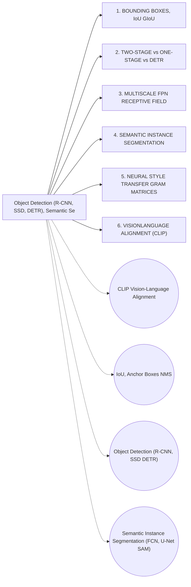

# Cheatsheet — Object Detection (R-CNN, SSD, DETR), Semantic Segmentation (FCN, U-Net, SAM) & Vision-Language Models

> [!summary] 10-Second Visual Hook
> Localize with anchors or Hungarian set matching, decode dense masks via FCN/U-Net, and align vision with language via CLIP

- **Full Monograph:** [[Object Detection (R-CNN, SSD, DETR), Semantic Segmentation (FCN, U-Net, SAM) & Vision-Language Models]]
- **Sub-Topic MOC:** [[ST 03 - Object Detection, Segmentation & Vision-Language Understanding]]
- **Atomic Concepts:** [[CLIP & Vision-Language Alignment]], [[IoU, Anchor Boxes & NMS]], [[Object Detection (R-CNN, SSD & DETR)]], [[Semantic & Instance Segmentation (FCN, U-Net & SAM)]]

## Interactive Mindmap Overview

## Branch Summary & Key Equations

- **1. BOUNDING BOXES, IoU & GIoU**
  $$
  \mathrm{IoU}(A,B)=\frac{|A\cap B|}{|A\cup B|},  \mathcal{L}_{\mathrm{GIoU}}=1-\mathrm{IoU}+\frac{|C\setminus(A\cup B)|}{|C|}
  $$
- **2. TWO-STAGE vs ONE-STAGE vs DETR**
- **3. MULTISCALE FPN & RECEPTIVE FIELD**
- **4. SEMANTIC & INSTANCE SEGMENTATION**
  $$
  \text{Fwd: } \boldsymbol{W}^{\top}\boldsymbol{x} \text{(Transp. Conv)},   \text{U-Net: } \mathrm{Dec}(\mathrm{Up}(\boldsymbol{z}) \| \boldsymbol{f}_{\mathrm{enc}})
  $$
- **5. NEURAL STYLE TRANSFER & GRAM MATRICES**
  $$
  G_{ij}^l = \sum_k F_{ik}^l F_{jk}^l,  \mathcal{L}=\alpha\mathcal{L}_{\mathrm{content}}+\beta\mathcal{L}_{\mathrm{style}}
  $$
- **6. VISION–LANGUAGE ALIGNMENT (CLIP)**
  $$
  \mathcal{L}_{\mathrm{CLIP}}=-\frac{1}{2B}\sum_i\Big[\log\frac{e^{\langle \boldsymbol{u}_i, \boldsymbol{v}_i \rangle/\tau}}{\sum_j e^{\langle \boldsymbol{u}_i, \boldsymbol{v}_j \rangle/\tau}}+\log\frac{e^{\langle \boldsymbol{u}_i, \boldsymbol{v}_i \rangle/\tau}}{\sum_j e^{\langle \boldsymbol{u}_j, \boldsymbol{v}_i \rangle/\tau}}\Big]
  $$

## Related Sources

[[Source - Antonio Torralba, Phillip Isola, and William Freeman]], [[Source - Dive into Deep Learning]], [[Source - Probabilistic Machine Learning]], [[Source - Understanding Deep Learning]]
