# Cheatsheet — Outside-In Agent Evaluation, LLM-as-a-Judge, Observability, Guardrails & AgentOps CI/CD

> [!summary] 10-Second Visual Hook
> Validate outcomes outside-in, trace trajectories glass-box, de-bias pairwise judges & gate rollouts

- **Full Monograph:** [[Outside-In Agent Evaluation, LLM-as-a-Judge, Observability, Guardrails & AgentOps CI - CD]]
- **Sub-Topic MOC:** [[ST 07 - Evaluation, Observability, Guardrails & AgentOps]]
- **Atomic Concepts:** [[AgentOps & pass^k Reliability]]

## Interactive Mindmap Overview

```mermaid
flowchart LR
  ROOT["Outside-In Agent Evaluation, LLM-as-a-Judge, Obs"]
  B1["1. WHAT Outside-In Four Pillars"]
  ROOT --> B1
  B2["2. HORIZON DECAY passk vs. pass k"]
  ROOT --> B2
  B3["3. LLM-AS-A-JUDGE HITL ALIGNMENT"]
  ROOT --> B3
  B4["4. SLICING, SIMPSONS PARADOX DEFERRAL"]
  ROOT --> B4
  B5["5. EVALUATOR GUARDRAIL STACK"]
  ROOT --> B5
  B6["6. OPENTELEMETRY AGENTOPS FLYWHEEL"]
  ROOT --> B6
  C1(("AgentOps passk Reliability"))
  ROOT -.-> C1
```

## Branch Summary & Key Equations

- **1. WHAT — Outside-In & Four Pillars**
  $$
  \tau=(s_0,z_1,a_1,o_1,\dots,z_H,a_H,o_H,y)
  $$
- **2. HORIZON DECAY — `pass@k` vs. `pass^ k`**
  $$
  \mathrm{pass@}k=1-(1-p_\tau)^k,  \mathrm{pass^}k=p_\tau^k=p_{\mathrm{step}}^{kH}
  $$
- **3. LLM-AS-A-JUDGE & HITL ALIGNMENT**
  $$
  \hat w_{A\succ B}(x)=\tfrac{1}{2}\bigl[J_\phi(y_A,y_B\mid x)+\bigl(1-J_\phi(y_B,y_A\mid x)\bigr)\bigr]
  $$
- **4. SLICING, SIMPSON'S PARADOX & DEFERRAL**
  $$
  \tau_{\mathrm{conf}}(r_a)=1-\frac{C_{\mathrm{HITL}}}{C_{\mathrm{err}}(r_a)} \bigl(C_{\mathrm{err}}\gg C_{\mathrm{HITL}}\Rightarrow\tau_{\mathrm{conf}}\to 1\bigr)
  $$
- **5. EVALUATOR & GUARDRAIL STACK**
- **6. OPENTELEMETRY & AGENTOPS FLYWHEEL**

## Related Sources

[[Source - A practical]], [[Source - Agent Quality]], [[Source - Designing Machine Learning Systems]], [[Source - Prototype to]], [[Source - Reinforcement Learning from Human Feedback]]
