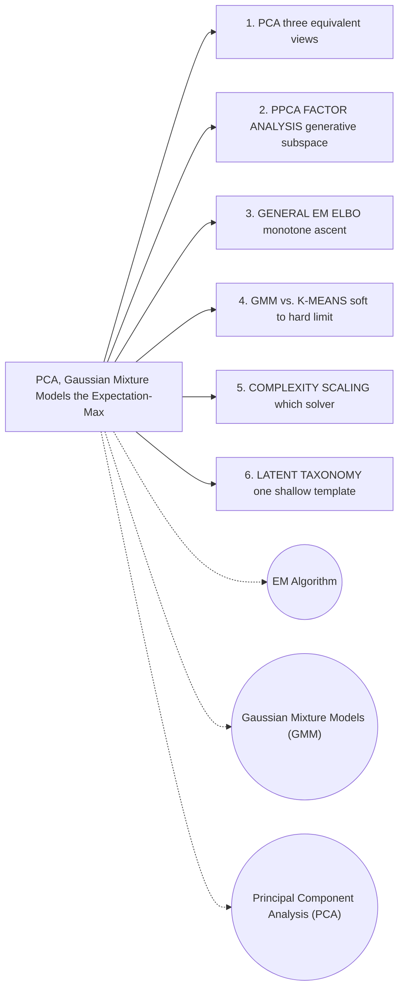

# Cheatsheet — PCA, Gaussian Mixture Models & the Expectation-Maximization Algorithm

> [!summary] 10-Second Visual Hook
> Subspaces & soft clusters via alternating E-step (tighten ELBO) and M-step (climb surrogate)

- **Full Monograph:** [[PCA, Gaussian Mixture Models & the Expectation-Maximization Algorithm]]
- **Sub-Topic MOC:** [[ST 02 - PCA, Factor Analysis, Mixture Models & EM]]
- **Atomic Concepts:** [[EM Algorithm]], [[Gaussian Mixture Models (GMM)]], [[Principal Component Analysis (PCA)]]

## Interactive Mindmap Overview

## Branch Summary & Key Equations

- **1. PCA — three equivalent views**
  $$
  \boldsymbol{S} = \frac{1}{N}\tilde{\boldsymbol{X}}^{\top}\tilde{\boldsymbol{X}} = \boldsymbol{U}\boldsymbol{\Lambda}\boldsymbol{U}^{\top}
  $$
- **2. PPCA & FACTOR ANALYSIS — generative subspace**
  $$
  \boldsymbol{z}_n\sim\mathcal{N}(\boldsymbol{0},\boldsymbol{I}_M),  \boldsymbol{x}_n\mid\boldsymbol{z}_n\sim\mathcal{N}(\boldsymbol{W}\boldsymbol{z}_n+\boldsymbol{\mu}, \boldsymbol{\Psi})
  $$
- **3. GENERAL EM — ELBO & monotone ascent**
  $$
  \log p(\boldsymbol{X}\mid\boldsymbol{\theta}) = \mathcal{L}(q,\boldsymbol{\theta}) + D_{\mathrm{KL}}(q(\boldsymbol{Z}) \parallel p(\boldsymbol{Z}\mid\boldsymbol{X},\boldsymbol{\theta}))
  $$
- **4. GMM vs. K-MEANS — soft to hard limit**
  $$
  r_{nk} = \frac{\pi_k\mathcal{N}(\boldsymbol{x}_n\mid\boldsymbol{\mu}_k,\boldsymbol{\Sigma}_k)}{\sum_{j=1}^K \pi_j\mathcal{N}(\boldsymbol{x}_n\mid\boldsymbol{\mu}_j,\boldsymbol{\Sigma}_j)},  N_k = \sum_{n=1}^N r_{nk}
  $$
- **5. COMPLEXITY & SCALING — which solver?**
- **6. LATENT TAXONOMY — one shallow template**

## Related Sources

[[Source - Foundations]], [[Source - Machine Learning co ban]], [[Source - Mathematics for Machine Learning]], [[Source - Probabilistic Machine Learning]]
