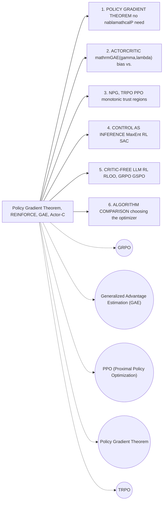

# Cheatsheet — Policy Gradient Theorem, REINFORCE, GAE, Actor-Critic, TRPO/PPO & RL-as-Inference

> [!summary] 10-Second Visual Hook
> Push up log-probabilities weighted by advantage; clip ratio steps inside a trust region

- **Full Monograph:** [[Policy Gradient Theorem, REINFORCE, GAE, Actor-Critic, TRPO - PPO & RL-as-Inference]]
- **Sub-Topic MOC:** [[ST 06 - Policy Gradients, Actor-Critic, Model-Based RL & MARL]]
- **Atomic Concepts:** [[GRPO]], [[Generalized Advantage Estimation (GAE)]], [[PPO (Proximal Policy Optimization)]], [[Policy Gradient Theorem]], [[TRPO]]

## Interactive Mindmap Overview

## Branch Summary & Key Equations

- **1. POLICY GRADIENT THEOREM — no $\nabla\mathcal{P}$ needed**
  $$
  \nabla_{\boldsymbol{\theta}} J(\boldsymbol{\theta}) = \mathbb{E}_{s\sim\mu, a\sim\pi_{\boldsymbol{\theta}}}\!\Big[ A^{\pi_{\boldsymbol{\theta}}}(s,a) \nabla_{\boldsymbol{\theta}}\log\pi_{\boldsymbol{\theta}}(a\mid s)\Big]
  $$
- **2. ACTOR–CRITIC & $\mathrm{GAE}(\gamma,\lambda)$ — bias vs. variance**
  $$
  \hat{A}_t^{\mathrm{GAE}(\gamma,\lambda)} = \sum_{l=0}^{\infty}(\gamma\lambda)^l \delta_{t+l}^V,  \delta_t^V = r_t + \gamma V_{\boldsymbol{\phi}}(s_{t+1})- V_{\boldsymbol{\phi}}(s_t)
  $$
- **3. NPG, TRPO & PPO — monotonic trust regions**
  $$
  L^{\mathrm{CLIP}}(\boldsymbol{\theta})=\mathbb{E}_t\!\Big[\min\!\big(r_t(\boldsymbol{\theta})\hat{A}_t, \mathrm{clip}(r_t(\boldsymbol{\theta}),1{-}\varepsilon,1{+}\varepsilon)\hat{A}_t\big)\Big]
  $$
- **4. CONTROL AS INFERENCE — MaxEnt RL & SAC**
  $$
  p(o_t=1\mid s_t,a_t)=\exp(\alpha^{-1} r_t)\implies \max_{\pi}\mathbb{E}_\tau\!\left[\sum_t\big(r_t+\alpha\mathrm{H}(\pi(\cdot\mid s_t))\big)\right]
  $$
- **5. CRITIC-FREE LLM RL — RLOO, GRPO & GSPO**
  $$
  A_{i,t}^{\mathrm{GRPO}} = \frac{r_i - \mathrm{mean}(r_{1:G})}{\mathrm{std}(r_{1:G}) + 10^{-8}}
  $$
- **6. ALGORITHM COMPARISON — choosing the optimizer**

## Related Sources

[[Source - Francis Bach]], [[Source - Probabilistic Machine Learning]], [[Source - Reinforcement Learning - An Overview]], [[Source - Reinforcement Learning from Human Feedback]], [[Source - Understanding Deep Learning]]
