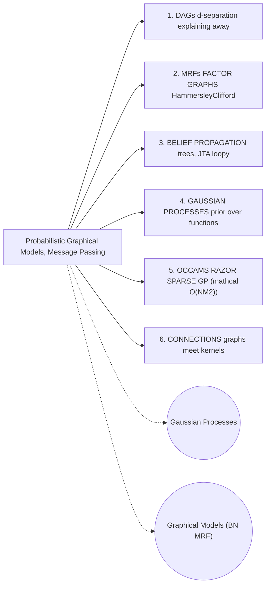

# Cheatsheet — Probabilistic Graphical Models, Message Passing & Gaussian Processes

> [!summary] 10-Second Visual Hook
> Graph topology factorizes joints; message passing marginalizes trees; kernels put priors on functions

- **Full Monograph:** [[Probabilistic Graphical Models, Message Passing & Gaussian Processes]]
- **Sub-Topic MOC:** [[ST 02 - Graphical Models, Gaussian Processes, Variational Inference & MCMC]]
- **Atomic Concepts:** [[Gaussian Processes]], [[Graphical Models (BN & MRF)]]

## Interactive Mindmap Overview

## Branch Summary & Key Equations

- **1. DAGs — d-separation & explaining away**
  $$
  p(\boldsymbol{x}) = \prod_{i=1}^D p(x_i\mid\boldsymbol{x}_{\mathrm{pa}(i)})
  $$
- **2. MRFs & FACTOR GRAPHS — Hammersley–Clifford**
  $$
  p(\boldsymbol{x}) = \frac{1}{Z}\prod_{c\in\mathcal C}\psi_c(\boldsymbol{x}_c) = \frac{1}{Z}\exp\!\Bigl(-\sum_{c\in\mathcal C} E_c(\boldsymbol{x}_c)\Bigr)
  $$
- **3. BELIEF PROPAGATION — trees, JTA & loopy**
  $$
  m_{s\to t}(z_t) = \sum_{z_s}\psi_{st}(z_s,z_t)\psi_s(z_s)\!\prod_{u\in\mathrm{nbr}(s)\setminus\{t\}}\! m_{u\to s}(z_s)
  $$
- **4. GAUSSIAN PROCESSES — prior over functions**
  $$
  p(\boldsymbol{f}_*\mid\boldsymbol{X}_*,\mathcal D) = \mathcal{N}(\boldsymbol{\mu}_*,\boldsymbol{\Sigma}_*),\quad \boldsymbol{K}_y=\boldsymbol{K}_{X,X}+\sigma_y^2\boldsymbol{I}_N
  $$
- **5. OCCAM'S RAZOR & SPARSE GP (\mathcal O(NM^2))**
  $$
  \log p(\boldsymbol{y}\mid\boldsymbol{X},\boldsymbol{\theta}) = \underbrace{-\tfrac{1}{2}\boldsymbol{y}^{\top}\boldsymbol{K}_y^{-1}\boldsymbol{y}}_{\text{data fit}} \underbrace{-\tfrac{1}{2}\log\det\boldsymbol{K}_y}_{\text{complexity}} - \tfrac{N}{2}\log(2\pi)
  $$
- **6. CONNECTIONS — graphs meet kernels**

## Related Sources

[[Source - Deep Learning]], [[Source - Foundations]], [[Source - Probabilistic Machine Learning]]
