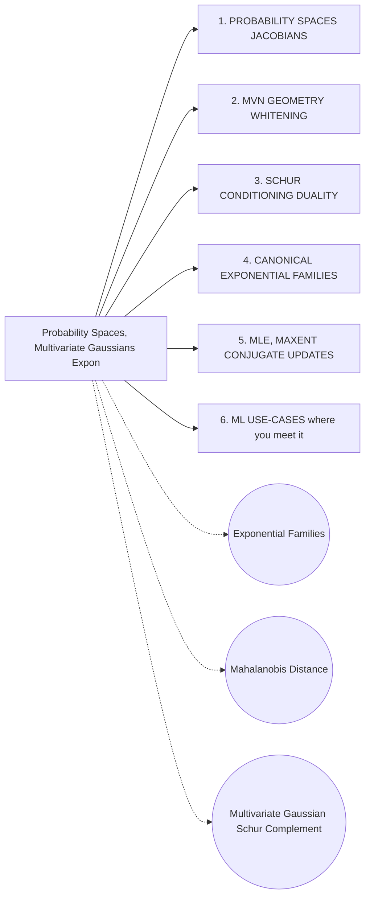

# Cheatsheet — Probability Spaces, Multivariate Gaussians & Exponential Families

> [!summary] 10-Second Visual Hook
> Gaussians turn conditioning into Schur complements; exponential families turn log-partition derivatives into moments

- **Full Monograph:** [[Probability Spaces, Multivariate Gaussians & Exponential Families]]
- **Sub-Topic MOC:** [[ST 01 - Probability Spaces, Gaussians & Statistical Estimation]]
- **Atomic Concepts:** [[Exponential Families]], [[Mahalanobis Distance]], [[Multivariate Gaussian & Schur Complement]]

## Interactive Mindmap Overview

## Branch Summary & Key Equations

- **1. PROBABILITY SPACES & JACOBIANS**
  $$
  p_{\boldsymbol{y}}(\boldsymbol{y}) = p_{\boldsymbol{x}}(\boldsymbol{f}^{-1}(\boldsymbol{y}))\lvert \det\boldsymbol{J}_{\boldsymbol{f}^{-1}}(\boldsymbol{y}) \rvert
  $$
- **2. MVN GEOMETRY & WHITENING**
  $$
  p(\boldsymbol{x}) = (2\pi)^{-D/2}\lvert \boldsymbol{\Sigma} \rvert^{-1/2}e^{-\frac{1}{2}\Delta^2(\boldsymbol{x})}
  $$
- **3. SCHUR CONDITIONING & DUALITY**
  $$
  \boldsymbol{\mu}_{a\mid b} = \boldsymbol{\mu}_a + \boldsymbol{\Sigma}_{ab}\boldsymbol{\Sigma}_{bb}^{-1}(\boldsymbol{x}_b-\boldsymbol{\mu}_b) = \boldsymbol{\mu}_a - \boldsymbol{\Lambda}_{aa}^{-1}\boldsymbol{\Lambda}_{ab}(\boldsymbol{x}_b-\boldsymbol{\mu}_b)
  $$
- **4. CANONICAL EXPONENTIAL FAMILIES**
  $$
  p(\boldsymbol{x}\mid\boldsymbol{\eta}) = h(\boldsymbol{x})\exp\!\big(\langle \boldsymbol{\eta}, \boldsymbol{T}(\boldsymbol{x}) \rangle - A(\boldsymbol{\eta})\big)
  $$
- **5. MLE, MAXENT & CONJUGATE UPDATES**
- **6. ML USE-CASES — where you meet it**

## Related Sources

[[Source - Foundations]], [[Source - Introduction-PROBABILITY-for-DATA-SCIENCE]], [[Source - Mathematics for Machine Learning]], [[Source - Probabilistic Machine Learning]]
