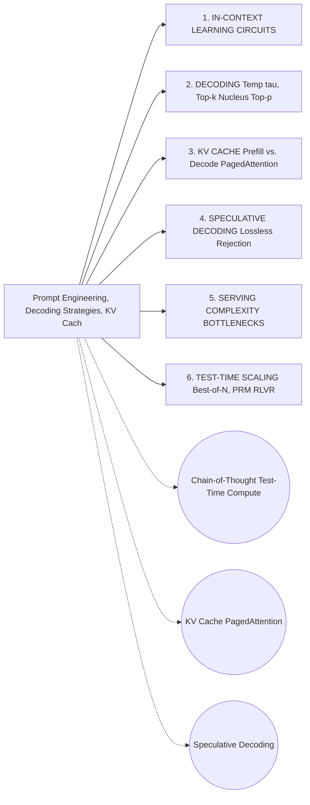

# Cheatsheet — Prompt Engineering, Decoding Strategies, KV Caching & Test-Time Scaling

> [!summary] 10-Second Visual Hook
> Condition in-context $\cdot$ truncate the unreliable tail $\cdot$ cache KV blocks $\cdot$ verify draft/reasoning rollouts

- **Full Monograph:** [[Prompt Engineering, Decoding Strategies, KV Caching & Test-Time Scaling]]
- **Sub-Topic MOC:** [[ST 05 - Prompting, Decoding, KV Caching & Test-Time Compute]]
- **Atomic Concepts:** [[Chain-of-Thought & Test-Time Compute]], [[KV Cache & PagedAttention]], [[Speculative Decoding]]

## Interactive Mindmap Overview

## Branch Summary & Key Equations

- **1. IN-CONTEXT LEARNING & CIRCUITS**
  $$
  \Pr(\boldsymbol{y}_{\mathrm{ans}}\mid\boldsymbol{x}) = \sum_{\boldsymbol{z}}\Pr(\boldsymbol{y}_{\mathrm{ans}}\mid\boldsymbol{x},\boldsymbol{z})\Pr(\boldsymbol{z}\mid\boldsymbol{x})
  $$
- **2. DECODING — Temp $\tau$, Top-$k$ & Nucleus Top-$p$**
  $$
  p_\tau(w_j) = \frac{\exp(u_j/\tau)}{\sum_v \exp(u_v/\tau)},  m^* = \min\Bigl\{m : \sum_{r=1}^m p_\tau(w_{(r)}) \ge p\Bigr\}
  $$
- **3. KV CACHE — Prefill vs. Decode & PagedAttention**
  $$
  M_{\mathrm{KV}} = 2 b s n_{\mathrm{layers}} n_{\mathrm{kv}} d_h p_{\mathrm{bytes}}
  $$
- **4. SPECULATIVE DECODING — Lossless Rejection**
  $$
  \text{Accept }\hat{y}\sim q\text{ w.p. }\min\!\left(1,\frac{p(\hat{y})}{q(\hat{y})}\right);  p_{\mathrm{res}}(y) = \frac{\max(0,p(y)-q(y))}{1-\sum_v\min(p(v),q(v))}
  $$
- **5. SERVING COMPLEXITY & BOTTLENECKS**
- **6. TEST-TIME SCALING — Best-of-$N$, PRM & RLVR**

## Related Sources

[[Source - Build a Large Language Model (From Scratch) (for sam speaks)]], [[Source - Foundations of Large Language Models]], [[Source - Reinforcement Learning from Human Feedback]], [[Source - Speech and Language Processing]]
