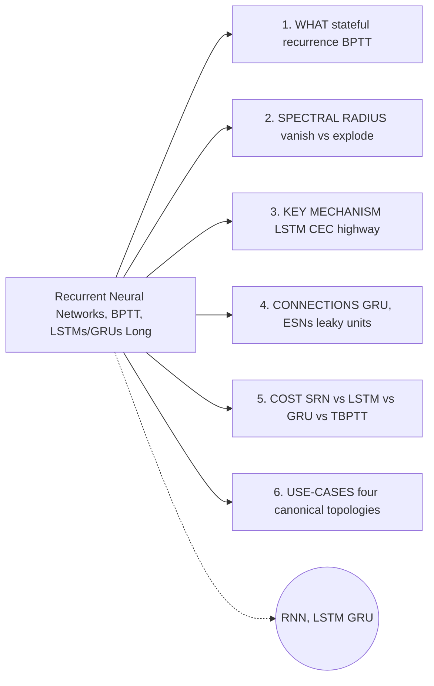

# Cheatsheet — Recurrent Neural Networks, BPTT, LSTMs/GRUs & Long-Range Gradient Flow

> [!summary] 10-Second Visual Hook
> Share weights across time; replace multiplicative $\boldsymbol{W}_{hh}^T$ decay with an additive gated memory highway

- **Full Monograph:** [[Recurrent Neural Networks, BPTT, LSTMs - GRUs & Long-Range Gradient Flow]]
- **Sub-Topic MOC:** [[ST 03 - Recurrent Networks & Selective State-Space Models (Mamba)]]
- **Atomic Concepts:** [[RNN, LSTM & GRU]]

## Interactive Mindmap Overview

## Branch Summary & Key Equations

- **1. WHAT — stateful recurrence & BPTT**
  $$
  \boldsymbol{h}_t = \phi(\boldsymbol{W}_{hh}\boldsymbol{h}_{t-1}+\boldsymbol{W}_{hx}\boldsymbol{x}_t+\boldsymbol{b}_h)
  $$
- **2. SPECTRAL RADIUS — vanish vs explode**
  $$
  \lVert \frac{\partial \boldsymbol{h}_t}{\partial \boldsymbol{h}_k} \rVert_2 \le \bigl(\gamma \sigma_{\max}(\boldsymbol{W}_{hh})\bigr)^{t-k}
  $$
- **3. KEY MECHANISM — LSTM & CEC highway**
  $$
  \boldsymbol{c}_t = \boldsymbol{f}_t \odot \boldsymbol{c}_{t-1} + \boldsymbol{i}_t \odot \tilde{\boldsymbol{c}}_t,\qquad \boldsymbol{h}_t = \boldsymbol{o}_t \odot \tanh(\boldsymbol{c}_t)
  $$
- **4. CONNECTIONS — GRU, ESNs & leaky units**
- **5. COST — SRN vs LSTM vs GRU vs TBPTT**
- **6. USE-CASES — four canonical topologies**

## Related Sources

[[Source - Deep Learning]], [[Source - Probabilistic Machine Learning]], [[Source - Speech and Language Processing]]
