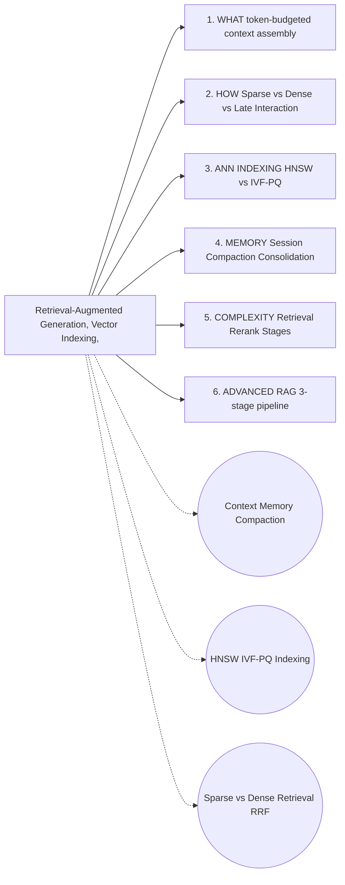

# Cheatsheet — Retrieval-Augmented Generation, Vector Indexing, Context Engineering & Agent Memory

> [!summary] 10-Second Visual Hook
> Fuse sparse BM25 + dense HNSW via RRF, rerank top-$k$, and assemble token-budgeted context + consolidated memory

- **Full Monograph:** [[Retrieval-Augmented Generation, Vector Indexing, Context Engineering & Agent Memory]]
- **Sub-Topic MOC:** [[ST 07 - RAG, Context Engineering, Memory & Tool - Agent Protocols]]
- **Atomic Concepts:** [[Context Memory & Compaction]], [[HNSW & IVF-PQ Indexing]], [[Sparse vs Dense Retrieval & RRF]]

## Interactive Mindmap Overview

## Branch Summary & Key Equations

- **1. WHAT — token-budgeted context assembly**
  $$
  C_t=\mathcal{A}(I_{\mathrm{sys}},\mathcal{T},\mathcal{R}_{\mathrm{mem}},\mathcal{K}_{\mathrm{comp}},\mathcal{R}_{\mathrm{rag}},q_t),  \lvert C_t \rvert_{\mathrm{tok}}\le B_{\max}-B_{\mathrm{out}}
  $$
- **2. HOW — Sparse vs Dense vs Late Interaction**
- **3. ANN INDEXING — HNSW vs IVF-PQ**
- **4. MEMORY — Session Compaction & Consolidation**
- **5. COMPLEXITY — Retrieval & Rerank Stages**
- **6. ADVANCED RAG — 3-stage pipeline**

## Related Sources

[[Source - Agents Book]], [[Source - Engineering -]], [[Source - LLM Engineer’s Handbook]], [[Source - Speech and Language Processing]]
