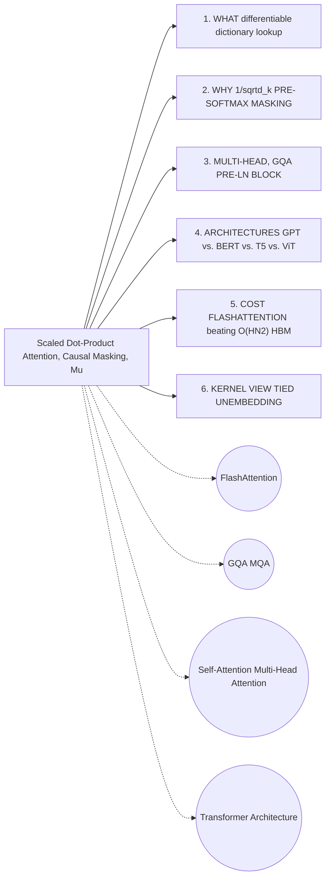

# Cheatsheet — Scaled Dot-Product Attention, Causal Masking, Multi-Head Attention & GPT/BERT Blocks

> [!summary] 10-Second Visual Hook
> Dynamic soft dictionary lookup $\cdot$ scale by $\sqrt{d_k}$ to save gradients $\cdot$ mask the future with $-\infty$

- **Full Monograph:** [[Scaled Dot-Product Attention, Causal Masking, Multi-Head Attention & GPT - BERT Blocks]]
- **Sub-Topic MOC:** [[ST 05 - Attention Mechanisms & Transformer Architectures]]
- **Atomic Concepts:** [[FlashAttention]], [[GQA & MQA]], [[Self-Attention & Multi-Head Attention]], [[Transformer Architecture]]

## Interactive Mindmap Overview

## Branch Summary & Key Equations

- **1. WHAT — differentiable dictionary lookup**
  $$
  \mathrm{Attention}(\boldsymbol{Q},\boldsymbol{K},\boldsymbol{V}) = \mathrm{softmax}\!\left(\frac{\boldsymbol{Q}\boldsymbol{K}^{\top}}{\sqrt{d_k}}\right)\boldsymbol{V}
  $$
- **2. WHY 1/\sqrt{d_k} & PRE-SOFTMAX MASKING**
  $$
  \mathrm{Var}(\boldsymbol{q}^{\top}\boldsymbol{k}) = d_k  \implies  \mathrm{Var}\!\left(\frac{\boldsymbol{q}^{\top}\boldsymbol{k}}{\sqrt{d_k}}\right) = 1
  $$
- **3. MULTI-HEAD, GQA & PRE-LN BLOCK**
  $$
  \mathrm{MHA}(\boldsymbol{X}) = \mathrm{Concat}(\boldsymbol{H}_1,\dots,\boldsymbol{H}_H)\boldsymbol{W}_O
  $$
- **4. ARCHITECTURES — GPT vs. BERT vs. T5 vs. ViT**
- **5. COST & FLASHATTENTION — beating O(HN^2) HBM**
- **6. KERNEL VIEW & TIED UNEMBEDDING**

## Related Sources

[[Source - Build a Large Language Model (From Scratch) (for sam speaks)]], [[Source - Foundations]], [[Source - Probabilistic Machine Learning]], [[Source - Speech and Language Processing]], [[Source - Understanding Deep Learning]]
