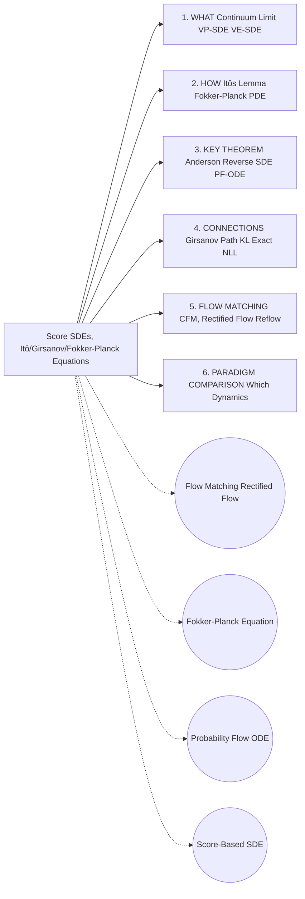

# Cheatsheet — Score SDEs, Itô/Girsanov/Fokker-Planck Equations & Flow Matching

> [!summary] 10-Second Visual Hook
> Continuous-time stochastic diffusion, deterministic probability flows, and straight-line transport

- **Full Monograph:** [[Score SDEs, Itô - Girsanov - Fokker-Planck Equations & Flow Matching]]
- **Sub-Topic MOC:** [[ST 04 - DDPM, NCSN, Score SDEs & Flow Matching]]
- **Atomic Concepts:** [[Flow Matching & Rectified Flow]], [[Fokker-Planck Equation]], [[Probability Flow ODE]], [[Score-Based SDE]]

## Interactive Mindmap Overview

## Branch Summary & Key Equations

- **1. WHAT — Continuum Limit: VP-SDE & VE-SDE**
  $$
  \mathrm{d}\boldsymbol{x}_t=\boldsymbol{f}(\boldsymbol{x}_t,t) \mathrm{d}t+g(t) \mathrm{d}\boldsymbol{w}_t,  \mathrm{d}\boldsymbol{w}_t\sim\mathcal{N}(\boldsymbol{0},\mathrm{d}t \boldsymbol{I})
  $$
- **2. HOW — Itô's Lemma & Fokker-Planck PDE**
  $$
  (\mathrm{d}w_{t,i})(\mathrm{d}w_{t,j})=\delta_{ij} \mathrm{d}t
  $$
- **3. KEY THEOREM — Anderson Reverse SDE & PF-ODE**
  $$
  \mathrm{d}\bar{\boldsymbol{x}}_t=\bigl[\boldsymbol{f}(\bar{\boldsymbol{x}}_t,t)-g^2(t)\nabla_{\boldsymbol{x}}\log p_t(\bar{\boldsymbol{x}}_t)\bigr]\mathrm{d}t+g(t) \mathrm{d}\bar{\boldsymbol{w}}_t
  $$
- **4. CONNECTIONS — Girsanov Path KL & Exact NLL**
  $$
  D_{\mathrm{KL}}(\mathbb P \parallel \mathbb P_\phi)=\frac{1}{2}\mathbb{E}_{\mathbb P}\!\left[\int_0^T g^2(t)\lVert \boldsymbol{s}_\phi(\boldsymbol{x}_t,t)-\nabla\log p_t(\boldsymbol{x}_t) \rVert_2^2\mathrm{d}t\right]
  $$
- **5. FLOW MATCHING — CFM, Rectified Flow & Reflow**
  $$
  \mathcal L_{\mathrm{RF}}=\mathbb{E}_{t,(\boldsymbol{x}_0,\boldsymbol{x}_1)}\!\bigl[\lVert \boldsymbol{v}_\phi(\boldsymbol{x}_t,t)-(\boldsymbol{x}_1-\boldsymbol{x}_0) \rVert_2^2\bigr]
  $$
- **6. PARADIGM COMPARISON — Which Dynamics?**

## Related Sources

[[Source - Probabilistic Machine Learning]], [[Source - The Principles of Diffusion Models]], [[Source - Tutorial on Diffusion Models for Imaging and Vision]]
