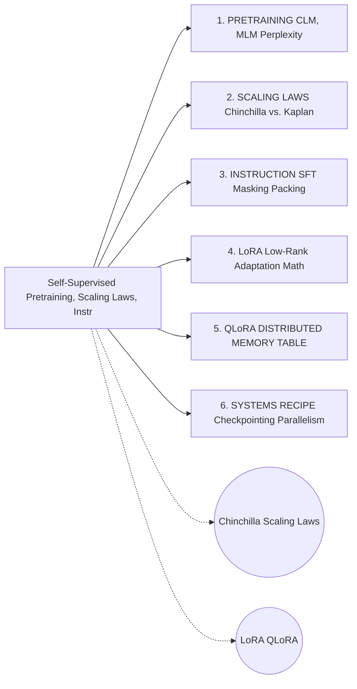

# Cheatsheet — Self-Supervised Pretraining, Scaling Laws, Instruction Fine-Tuning & LoRA/QLoRA

> [!summary] 10-Second Visual Hook
> Predict the next token at scale $\cdot$ balance $N^*\propto C^{0.5}$ and $D^*\propto C^{0.5}$ $\cdot$ adapt via rank-$r$ bypass $\frac{\alpha}{r}\boldsymbol{B}\boldsymbol{A}$

- **Full Monograph:** [[Self-Supervised Pretraining, Scaling Laws, Instruction Fine-Tuning & LoRA - QLoRA]]
- **Sub-Topic MOC:** [[ST 05 - Pretraining, Scaling Laws & Parameter-Efficient Fine-Tuning]]
- **Atomic Concepts:** [[Chinchilla Scaling Laws]], [[LoRA & QLoRA]]

## Interactive Mindmap Overview

## Branch Summary & Key Equations

- **1. PRETRAINING — CLM, MLM & Perplexity**
  $$
  \mathcal{L}_{\mathrm{CE}}(\theta;\boldsymbol{x}) = -\frac{1}{m}\sum_{i=0}^{m-1}\log\mathbb{P}_\theta(x_{i+1}\mid x_{\le i}),\quad \mathrm{PPL} = \exp(\mathcal{L}_{\mathrm{CE}})
  $$
- **2. SCALING LAWS — Chinchilla vs. Kaplan**
  $$
  L(N,D) = E + \frac{A}{N^\alpha} + \frac{B}{D^\beta},\quad C \approx 6ND
  $$
- **3. INSTRUCTION SFT — Masking & Packing**
  $$
  \mathcal{L}_{\mathrm{SFT}} = -\frac{\sum_{t:y_t\neq -100}\log\mathbb{P}_\theta(y_t\mid x_{\le t})}{\sum_t \mathbb{I}[y_t\neq -100]}
  $$
- **4. LoRA — Low-Rank Adaptation Math**
  $$
  \boldsymbol{h} = \boldsymbol{W}_0\boldsymbol{x} + \frac{\alpha}{r}\boldsymbol{B}\boldsymbol{A}\boldsymbol{x},\qquad \boldsymbol{A}\in\mathbb{R}^{r\times d_{\mathrm{in}}}, \boldsymbol{B}\in\mathbb{R}^{d_{\mathrm{out}}\times r}
  $$
- **5. QLoRA & DISTRIBUTED MEMORY TABLE**
- **6. SYSTEMS RECIPE — Checkpointing & Parallelism**

## Related Sources

[[Source - Build a Large Language Model (From Scratch) (for sam speaks)]], [[Source - Foundations of Large Language Models]], [[Source - LLM Engineer’s Handbook]], [[Source - Reinforcement Learning from Human Feedback]], [[Source - Speech and Language Processing]]
