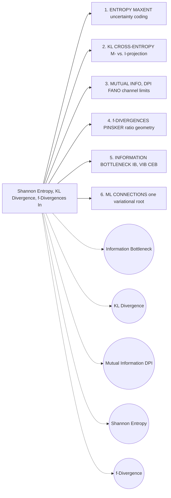

# Cheatsheet — Shannon Entropy, KL Divergence, f-Divergences & Information Bottleneck

> [!summary] 10-Second Visual Hook
> Measure uncertainty in nats/bits, compare densities via convex ratios, and squeeze nuisance via bottlenecks

- **Full Monograph:** [[Shannon Entropy, KL Divergence, f-Divergences & Information Bottleneck]]
- **Sub-Topic MOC:** [[ST 01 - Information Theory, Divergences & Optimal Transport]]
- **Atomic Concepts:** [[Information Bottleneck]], [[KL Divergence]], [[Mutual Information & DPI]], [[Shannon Entropy]], [[f-Divergence]]

## Interactive Mindmap Overview

## Branch Summary & Key Equations

- **1. ENTROPY & MAXENT — uncertainty & coding**
  $$
  \mathrm{H}(X)=-\sum_{x}p(x)\ln p(x)
  $$
- **2. KL & CROSS-ENTROPY — M- vs. I-projection**
  $$
  H_{\mathrm{ce}}(p,q)=\mathrm{H}(p)+D_{\mathrm{KL}}(p \parallel q),\quad D_{\mathrm{KL}}(p \parallel q)\ge 0
  $$
- **3. MUTUAL INFO, DPI & FANO — channel limits**
  $$
  \mathrm{I}(X;Y)=D_{\mathrm{KL}}(p(x,y) \parallel p(x)p(y))=\mathrm{H}(X)-\mathrm{H}(X|Y)\ge 0
  $$
- **4. f-DIVERGENCES & PINSKER — ratio geometry**
- **5. INFORMATION BOTTLENECK — IB, VIB & CEB**
  $$
  \min_{e(t|x)} \mathcal L_{\mathrm{IB}}=\beta \mathrm{I}(X;T)-\mathrm{I}(T;Y)
  $$
- **6. ML CONNECTIONS — one variational root**

## Related Sources

[[Source - Deep Learning]], [[Source - Foundations]], [[Source - Probabilistic Machine Learning]], [[Source - Understanding Deep Learning]]
