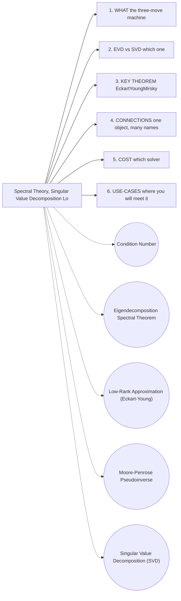

# Cheatsheet — Spectral Theory, Singular Value Decomposition & Low-Rank Approximations

> [!summary] 10-Second Visual Hook
> Every matrix = rotate $\cdot$ stretch $\cdot$ rotate; keep only the biggest stretches

- **Full Monograph:** [[Spectral Theory, Singular Value Decomposition & Low-Rank Approximations]]
- **Sub-Topic MOC:** [[ST 01 - Vector Spaces, Spectral Theory & Matrix Factorizations]]
- **Atomic Concepts:** [[Condition Number]], [[Eigendecomposition & Spectral Theorem]], [[Low-Rank Approximation (Eckart-Young)]], [[Moore-Penrose Pseudoinverse]], [[Singular Value Decomposition (SVD)]]

## Interactive Mindmap Overview

## Branch Summary & Key Equations

- **1. WHAT — the three-move machine**
  $$
  \boldsymbol{A}=\boldsymbol{U} \boldsymbol{\Sigma} \boldsymbol{V}^{\top}
  $$
- **2. EVD vs SVD — which one?**
- **3. KEY THEOREM — Eckart–Young–Mirsky**
  $$
  \boldsymbol{A}_k=\sum_{i=1}^{k}\sigma_i\boldsymbol{u}_i\boldsymbol{v}_i^{\top}
  $$
- **4. CONNECTIONS — one object, many names**
- **5. COST — which solver?**
- **6. USE-CASES — where you will meet it**

## Related Sources

[[Source - Deep Learning]], [[Source - E D I T I O N]], [[Source - Machine Learning co ban]], [[Source - Mathematics for Machine Learning]], [[Source - Probabilistic Machine Learning]]
