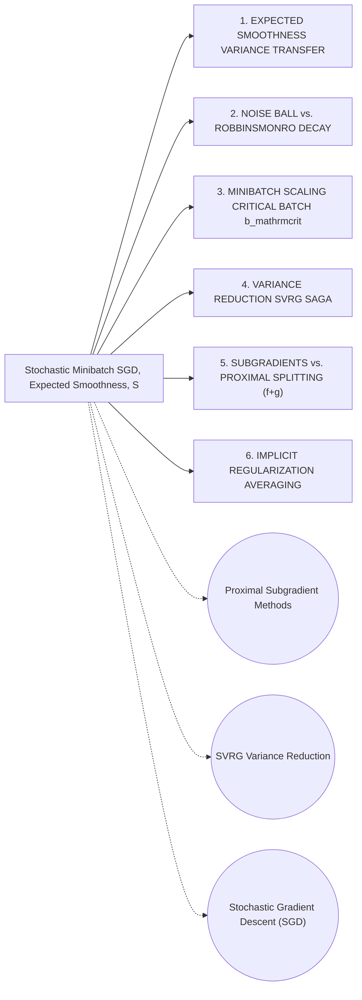

# Cheatsheet — Stochastic & Minibatch SGD, Expected Smoothness, Subgradients & Proximal Methods

> [!summary] 10-Second Visual Hook
> Constant-step SGD hits an $O(\eta\sigma_f^*/\mu)$ noise ball; pierce it via Robbins–Monro decay, $b_{\mathrm{crit}}$ batching, SVRG, or $\operatorname{prox}_{\eta g}$

- **Full Monograph:** [[Stochastic & Minibatch SGD, Expected Smoothness, Subgradients & Proximal Methods]]
- **Sub-Topic MOC:** [[ST 01 - Stochastic, Adaptive, Proximal & Second-Order Optimizers]]
- **Atomic Concepts:** [[Proximal & Subgradient Methods]], [[SVRG & Variance Reduction]], [[Stochastic Gradient Descent (SGD)]]

## Interactive Mindmap Overview

## Branch Summary & Key Equations

- **1. EXPECTED SMOOTHNESS & VARIANCE TRANSFER**
  $$
  \mathbb{E}\bigl[\lVert \nabla f_i(\boldsymbol{\theta})-\nabla f_i(\boldsymbol{\theta}^*) \rVert^2\bigr]\le 2L_{\max}\bigl(f(\boldsymbol{\theta})-\inf f\bigr)
  $$
- **2. NOISE BALL vs. ROBBINS–MONRO DECAY**
  $$
  \mathbb{E}\lVert \boldsymbol{\theta}_t-\boldsymbol{\theta}^* \rVert^2\le(1-\eta\mu)^t D_0^2+\frac{2\eta\sigma_f^*}{\mu}
  $$
- **3. MINIBATCH SCALING & CRITICAL BATCH $b_{\mathrm{crit}}$**
  $$
  L_b=\frac{n(b-1)}{b(n-1)}L_f+\frac{n-b}{b(n-1)}L_{\max},  \sigma_b^*=\frac{n-b}{b(n-1)}\sigma_f^*
  $$
- **4. VARIANCE REDUCTION — SVRG & SAGA**
  $$
  \boldsymbol{g}_t^{\mathrm{SVRG}}=\nabla f_{i_t}(\boldsymbol{\theta}_t)-\nabla f_{i_t}(\tilde{\boldsymbol{\theta}})+\nabla f(\tilde{\boldsymbol{\theta}})
  $$
- **5. SUBGRADIENTS vs. PROXIMAL SPLITTING ($f+g$)**
  $$
  \operatorname{prox}_{\eta g}(\boldsymbol{v})=\arg\min_{\boldsymbol{z}}\bigl\{g(\boldsymbol{z})+\tfrac{1}{2\eta}\lVert \boldsymbol{z}-\boldsymbol{v} \rVert_2^2\bigr\}
  $$
- **6. IMPLICIT REGULARIZATION & AVERAGING**

## Related Sources

[[Source - Deep Learning]], [[Source - Handbook of Convergence Theorems]], [[Source - Probabilistic Machine Learning]], [[Source - Understanding Deep Learning]]
