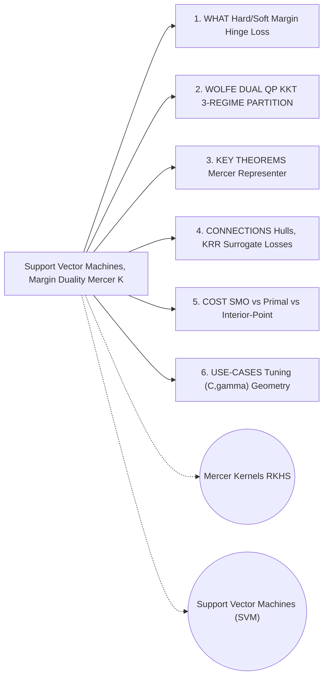

# Cheatsheet — Support Vector Machines, Margin Duality & Mercer Kernel Methods

> [!summary] 10-Second Visual Hook
> Maximize the margin $2/\lVert \boldsymbol{w} \rVert_2$, sparsify via KKT on the hinge corner, and lift inner products into RKHS $\mathcal{H}_k$

- **Full Monograph:** [[Support Vector Machines, Margin Duality & Mercer Kernel Methods]]
- **Sub-Topic MOC:** [[ST 02 - Kernel Methods, Support Vector Machines & Tree Ensembles]]
- **Atomic Concepts:** [[Mercer Kernels & RKHS]], [[Support Vector Machines (SVM)]]

## Interactive Mindmap Overview

## Branch Summary & Key Equations

- **1. WHAT — Hard/Soft Margin & Hinge Loss**
  $$
  \min_{\boldsymbol{w},b,\boldsymbol{\xi}} \frac{1}{2}\lVert \boldsymbol{w} \rVert_2^2+C\sum_{i=1}^N\xi_i \text{s.t.}  y_i(\langle \boldsymbol{w}, \boldsymbol{x}_i \rangle+b)\ge 1-\xi_i, \xi_i\ge 0
  $$
- **2. WOLFE DUAL QP & KKT 3-REGIME PARTITION**
  $$
  \max_{\boldsymbol{\alpha}\in[0,C]^N}\sum_{i=1}^N\alpha_i-\frac{1}{2}\sum_{i,j=1}^N\alpha_i\alpha_jy_iy_jk(\boldsymbol{x}_i,\boldsymbol{x}_j)  \text{s.t.} \sum_{i=1}^N\alpha_iy_i=0
  $$
- **3. KEY THEOREMS — Mercer & Representer**
  $$
  f^*(\boldsymbol{x})=\sum_{i\in\mathcal S}\alpha_iy_i k(\boldsymbol{x}_i,\boldsymbol{x})+b^*
  $$
- **4. CONNECTIONS — Hulls, KRR & Surrogate Losses**
- **5. COST — SMO vs Primal vs Interior-Point**
- **6. USE-CASES — Tuning $(C,\gamma)$ Geometry**

## Related Sources

[[Source - Deep Learning]], [[Source - Machine Learning co ban]], [[Source - Mathematics for Machine Learning]], [[Source - Probabilistic Machine Learning]]
