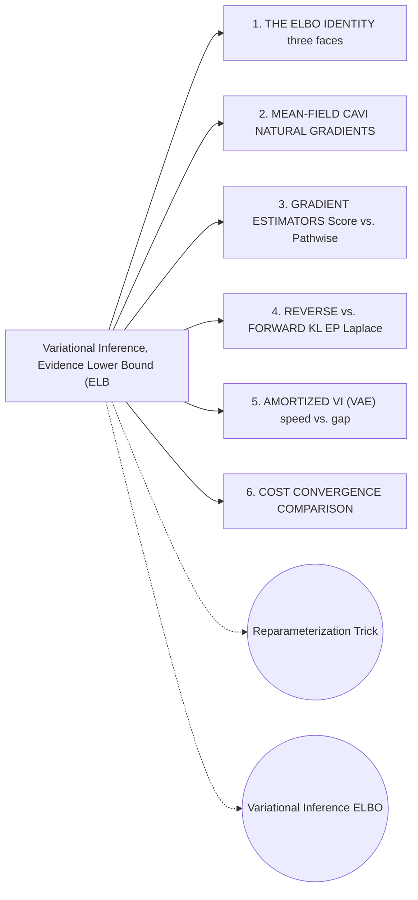

# Cheatsheet — Variational Inference, Evidence Lower Bound (ELBO) & Expectation Propagation

> [!summary] 10-Second Visual Hook
> Turn intractable integration into optimization: maximize the ELBO to squeeze reverse KL to zero

- **Full Monograph:** [[Variational Inference, Evidence Lower Bound (ELBO) & Expectation Propagation]]
- **Sub-Topic MOC:** [[ST 02 - Graphical Models, Gaussian Processes, Variational Inference & MCMC]]
- **Atomic Concepts:** [[Reparameterization Trick]], [[Variational Inference & ELBO]]

## Interactive Mindmap Overview

## Branch Summary & Key Equations

- **1. THE ELBO IDENTITY — three faces**
  $$
  \log p_{\boldsymbol{\theta}}(\boldsymbol{x}) = \mathrm{ELBO}(q;\boldsymbol{\theta}) + D_{\mathrm{KL}}(q(\boldsymbol{z}) \parallel p_{\boldsymbol{\theta}}(\boldsymbol{z}\mid\boldsymbol{x}))
  $$
- **2. MEAN-FIELD CAVI & NATURAL GRADIENTS**
  $$
  q(\boldsymbol{z})=\prod_{j=1}^J q_j(\boldsymbol{z}_j) \Longrightarrow  \log q_j^*(\boldsymbol{z}_j) = \mathbb{E}_{-j}[\log p_{\boldsymbol{\theta}}(\boldsymbol{x},\boldsymbol{z})] + \mathrm{const}
  $$
- **3. GRADIENT ESTIMATORS — Score vs. Pathwise**
- **4. REVERSE vs. FORWARD KL — EP & Laplace**
- **5. AMORTIZED VI (VAE) — speed vs. gap**
- **6. COST & CONVERGENCE COMPARISON**

## Related Sources

[[Source - Deep Learning]], [[Source - Foundations]], [[Source - Probabilistic Machine Learning]], [[Source - Understanding Deep Learning]]
